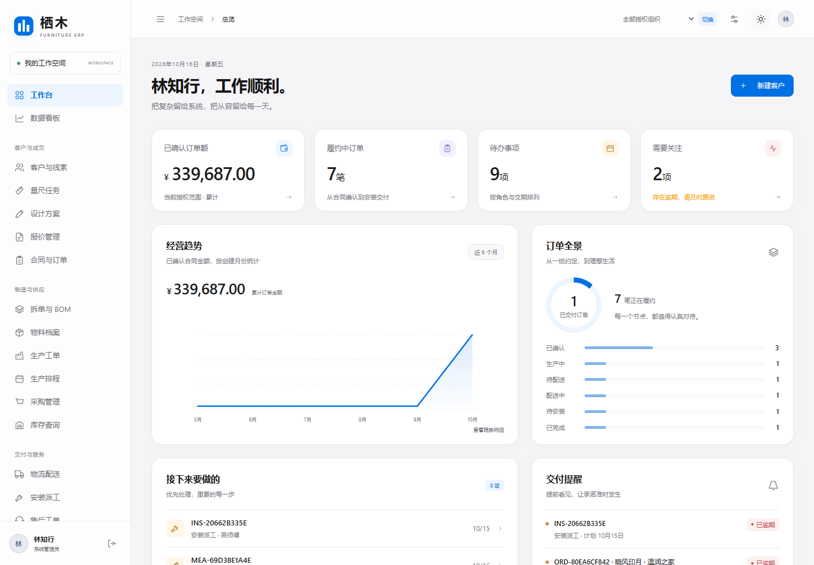

# 栖木 · 家居 ERP

基于 **Django 5.2 LTS + Tabler 开源组件** 的中文家居业务系统。以全屋定制为主，覆盖客户、量尺、设计、报价、合同、拆单、BOM、生产、采购、库存、配送、安装、售后与收付款对账。

真实数据库、真实登录、服务端组织/角色/本人范围权限和事务业务流转。界面采用苹果风格系统字体、克制留白、蓝色强调、毛玻璃导航、深浅主题和紧凑密度。移动端是响应式 Web。



## v1.1.4 五次评审修正

交接附件新增「停止共享」：当前上传者或源订单范围内的管理人员可填写原因归档误传文件，保留证据；同厂重发不恢复，已下载副本无法收回。逐单变更审批、来源订单/组织绑定、待批申请行移除与失效恢复、明确正负差额现已落地。附件读取改用版本校验，按父单复用权限，避免逐文件查询与GET写锁。

多角色不能拼接管理数据范围；添加/移除申请行也纳入最后编辑人防自审。移除失效行后须编辑核对当前订单版本，再由其他管理人员批准。

[查看 U1–U6 处理、业务取舍及验证](docs/V114_FIFTH_REVIEW_RESPONSE.md)。147用例、五组CI；运行与历史证据见[验证记录](docs/VALIDATION.md)。

## v1.1.3 四次评审修正

变更金额留空沿用当前合同，创建/编辑/明细/审批统一准备规则；折扣重算前展示原额→拟额、产品数和历史差异警告。交接附件按上传者删除，改派时旧附件自动归档，保留证据并隔离新工厂；撤回角色权限与源单范围同时校验。

已有零额待批申请请人工核对；完整补录仍须审批人对照合同/图纸检查。升级0016不重写旧附件或合同。

[查看 S1–S6 处理及归档规则](docs/V113_FOURTH_REVIEW_RESPONSE.md)。

## v1.1.2 三次评审修正

新增待接单交接撤回、申请人撤回待批变更、合同折扣审批更正和保留已收核销的分期修订。扩展采购/生产/收货/变更/交接附件，交接共享确认绑定版本和目标工厂；未知历史折扣须明确核对，不重算存量合同。

已收不挪期，仅按原未收比例重分余额，审批前有预览；原全部结清时新增未收归尾款。已接单撤回、生产后改单及退款仍需专门业务流程。

[查看 R1–R10 处理与运行说明](docs/V112_THIRD_REVIEW_RESPONSE.md)。

## v1.1.1 二次评审修正

已修复改单丢失面积/折扣、交接目标未授权、拒单不可恢复和内部客户重复问题。新增指定期次核销、交期同步分期日期、组织可选强制分期、流式附件上传/鉴权删除及CSV疑似重复检查。

管理员需在 `/admin/erp/collaborationroute/` 配置门店→工厂授权；普通门店人员无需取得工厂数据权限即可交接。历史待审批增减项升级后需重新核对申请，原明细与审计保留，历史合同金额不重算。

[查看 N1–N18 处理与验证记录](docs/V111_SECOND_REVIEW_RESPONSE.md)。

## v1.1 已落地的优化

按 [DeepSeek 评审采纳记录](docs/V11_REVIEW_RESPONSE.md) 与三维家、ERPNext 官方业务资料，新增：

- 投影面积/延米/展开面积/数量/套餐计价、免折费用、税额与参考毛利；独立订单明细及审批增减项。
- 私有图纸和照片附件；门店冻结规格交接，工厂独立接单生产并回传进度。
- 库存预留/可用量/采购在途、分批收货与超收拦截；分期回款、逾期及履约检查。
- 跟进记录、设计版本、供应商档案、客户/物料 CSV 导入及单据打印。
- SQL 聚合、请求级权限缓存、复合索引、健康检查、SQLite 在线备份及真实 PostgreSQL CI。

## 本地启动

需要 Python **3.12+**，首次安装依赖需要联网；运行页面不依赖外部 CDN，不需要 Node.js、Redis 或 Docker。

```bash
git clone https://github.com/3578190277jqx/erp.git
cd erp
git checkout feat/furniture-erp
python scripts/start.py --demo
```

Windows 也可双击 `run.bat`。访问 **http://127.0.0.1:8000**。

启动器自动创建项目 `.venv`、安装固定版本依赖、迁移数据库并初始化虚构演示数据。管理员账号 **demo_admin**，密码首次随机生成，显示在命令行，并保存在被 Git 忽略的 `.demo-credentials.txt`。没有写死的默认生产密码。`seed_demo` 重复运行不会重置密码或覆盖单据。

演示账号包括 `demo_sales`、`demo_designer`、`demo_surveyor`、`demo_engineer`、`demo_planner`、`demo_buyer`、`demo_warehouse`、`demo_logistics`、`demo_installer`、`demo_service`、`demo_finance`、`demo_manager`、`demo_boss` 和 `demo_dealer`，首次使用同一随机演示密码。杭州、宁波门店隔离，适合检查角色权限。演示数据均为虚构。

已有 Python 虚拟环境时，也可手动启动：

```bash
python -m pip install -r requirements.txt
python manage.py migrate
python manage.py seed_demo --credentials-file .demo-credentials.txt
python manage.py seed_upgrade_demo
python manage.py collectstatic --noinput
python manage.py runserver 127.0.0.1:8000
```

不需要演示数据时省略 `seed_demo`，运行 `python manage.py createsuperuser`，通过 `/admin/` 创建组织与成员。没有成员关系的普通账号不会获得业务数据。

## 业务怎么试

1. 客户详情新建报价 → 保存基本信息 → 添加产品明细 → 提交审核 → 管理角色批准 → 接受并生成订单。
2. 订单补齐合同编号与交期 → 确认合同 → 新建拆单 → 添加 BOM 物料行 → 提交 → 拆单员审核释放。
3. 系统自动生成生产工单 → 计划员编辑仓库、工作中心、日期 → 确认排程 → 仓管领料 → 计划员开工、完工。
4. 库存不足时整笔领料回滚。采购录入行 → 提交 → 店长/老板批准 → 采购下单 → 仓管收货，再尝试领料。
5. 订单生产完工后新建配送 → 派车 → 发运 → 签收 → 新建安装 → 派工 → 开始 → 填验收结论并完成。
6. 财务按订单或采购登记收付款，凭证号唯一，不能超过未结余额。订单改单通过“变更申请”，由另一管理人员审批，记录前后值和版本。

管理员可执行所有业务动作，便于演示闭环；普通角色按岗位授权。变更申请即使由管理员提交，也不能由本人审批。

## 模块与权限

| 领域 | 主要能力 |
|---|---|
| 工作台与报表 | 真实订单额、经营趋势、角色任务、交期风险、状态统计、安全库存预警 |
| 客户与成交 | 线索、客户资料、量尺、设计版本、报价明细与折扣、合同订单 |
| 制造与供应 | 拆单 BOM、物料、生产工单、人工排程看板、采购、仓库、库存及流水 |
| 交付与服务 | 物流派车及签收、安装派工与验收、失败重派、售后工单 |
| 经营与设置 | 收付款、应收应付余额、变更审批、CSV 导出、批量批准/派工、审计、组织权限 |

权限由服务器按组织成员关系与动作计算；“本人负责”“本组织”“本组织及下级”分别约束列表、详情、表单关联、报表、动作和导出。页面隐藏不是安全边界。已审核报价、已释放 BOM 及业务流水不能通过编辑表单改写。

## 验证与 CI

```bash
python manage.py check
python manage.py makemigrations --check --dry-run
python manage.py collectstatic --noinput
python manage.py test --verbosity 2
```

GitHub Actions 在 Ubuntu / Windows、Python 3.12 / 3.13 上运行相同检查，并检查生产安全配置。测试覆盖闭环、事务回滚、重复操作、权限隔离、外键篡改、CSRF、版本冲突、批量回滚、CSV 公式防护和演示数据幂等。

## 部署与数据库

本机使用 SQLite，数据库和生成密码均不提交 Git。正式部署请使用独立环境、HTTPS 反向代理并备份数据库；`runserver` 仅供开发。环境变量由进程读取，Django 不会自动读取 `.env` 文件；Docker Compose 会读取。

可选 Docker / Waitress 启动：

```bash
# 复制 .env.example 为 .env，填入随机 secret、域名与 HTTPS 来源
docker compose up --build -d
docker compose exec erp python manage.py createsuperuser
```

镜像不自动灌入演示账号。默认开启安全 Cookie 和 HTTPS 重定向，需要反向代理终止 HTTPS。设置 `DJANGO_TRUSTED_PROXY` 为 Waitress 实际看到的代理节点 IP，代理须覆盖并清理客户端传入的 `X-Forwarded-*`，再设置 `X-Forwarded-Proto=https`；不接受 `*` 通配信任。未设置代理信任时转发头会被清除。相同的生产服务器也可用 `python scripts/serve.py` 运行。SQLite 数据保存在 `erp-data` 卷。正式业务上线前请验证备份与恢复；当前开发机器未安装 Docker，容器构建状态见验证记录。

若使用 PostgreSQL，运行 `python -m pip install -r requirements-postgres.txt`，配置 `POSTGRES_HOST`、`POSTGRES_PORT`、`POSTGRES_DB`、`POSTGRES_USER` 和 `POSTGRES_PASSWORD` 后运行迁移。生产设置必须提供 `DJANGO_DEBUG=false`、随机 `DJANGO_SECRET_KEY`、`DJANGO_ALLOWED_HOSTS` 和 `DJANGO_CSRF_TRUSTED_ORIGINS`；GitHub CI 使用 PostgreSQL 16 执行迁移和双工单库存竞争测试；生产容量及备份恢复仍需部署环境验收。

健康检查为 `/healthz/`。升级前可运行：

```bash
python manage.py backup_db output/backups/before-upgrade.sqlite3
python manage.py migrate
```

备份目标必须为新文件。此命令只备份 SQLite 数据库，私有附件目录 `media/` 须另行备份；PostgreSQL 使用 `pg_dump`。恢复应在停止写入的独立副本上演练，核对单据/收付款/库存与附件完整性后再用于生产。

## 设计与交付文档

- [完整中文交互方案 v1.0](docs/superpowers/specs/2026-10-16-furniture-erp-design.md)：五阶段、流程图、12 个关键页面、权限及苹果风格细则。
- [开源调研与复用](docs/OPEN_SOURCE.md)：ERPNext / Odoo / InvenTree 的参考范围，Django / Tabler 的实际复用及许可证。
- [实施计划](docs/superpowers/plans/2026-10-16-furniture-erp.md)
- [v1.1 优化规格](docs/superpowers/specs/2026-10-16-erp-v11-design.md)
- [逐项采纳与边界](docs/V11_REVIEW_RESPONSE.md)
- [验证记录](docs/VALIDATION.md)

## 首版边界

财务为业务收付款及对账，未实现法定总账、税务申报、电子发票或银行直连。参考毛利不是实际成本核算。生产为人工排程、平铺 BOM 与领料，未实现板材套裁、MES 工序/质检、设备集成或多级审批引擎。采购已支持分批收货；销售多批配送、退货退款仍后续。门厂交接已实现基础闭环，接单后的改单/改派/撤回不自动处理；已拒单可受控重发。移动端为响应式 Web，无原生 App、离线、定位或设备扫码。

旧合同额不会因迁移重算；如与回填产品快照不符，页面会提示核对历史记录。已预留工单先释放才能换仓；已交接的产品及工厂订单不能单边取消或修改。已有分期计划的合同金额变更、退款与计划修订需要后续专项流程。

本仓库不是 ERPNext / Odoo / InvenTree 的 fork，未复制其业务源码。Tabler 1.6.1 CSS 本地复用并保留 MIT 许可证；Django 等依赖保留各自许可证。重新获取 UI 资产时才需要 npm：`npm pack @tabler/core@1.6.1` 后运行 `python scripts/vendor_assets.py tabler-core-1.6.1.tgz`。
