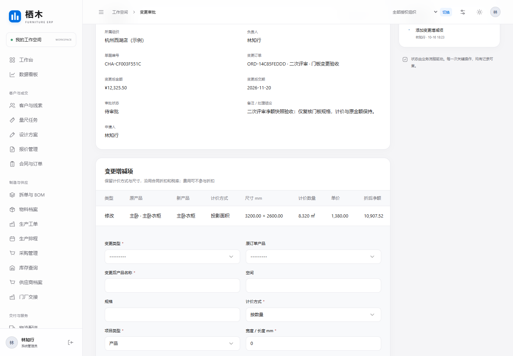
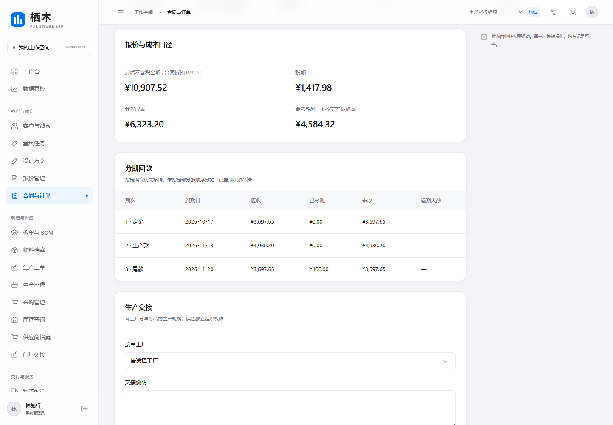
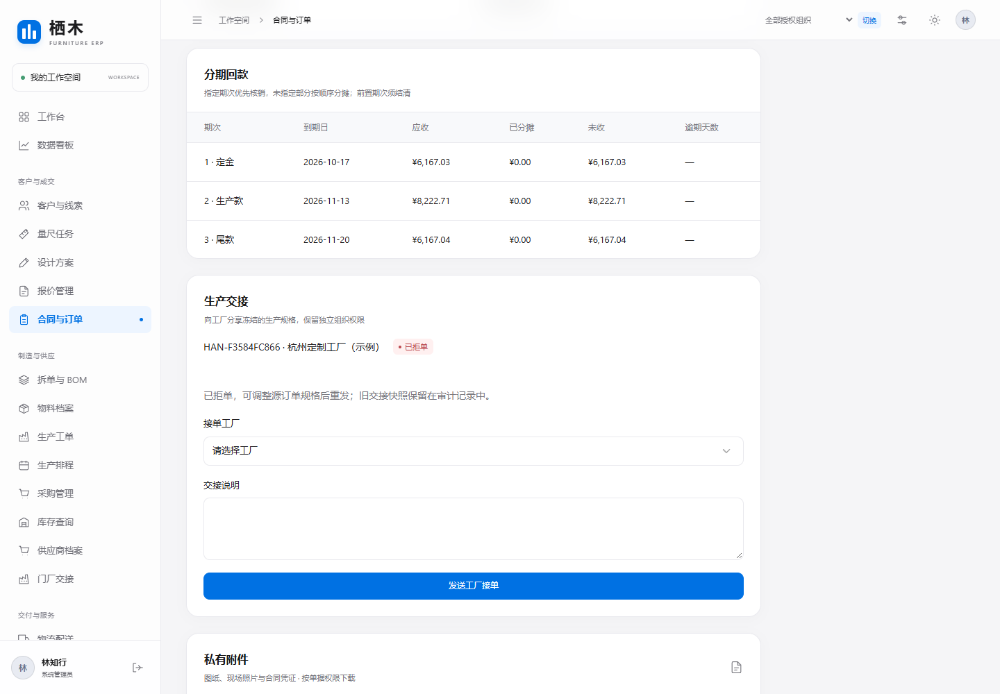

# 栖木 ERP v1.1.1 · 二次评审处理记录

日期：2026-10-16。二次评审为外部建议，先逐项核验再实施；保留原 Django/Tabler 架构、已有业务数据及 GitHub 提交历史。

## 核心结果

- 报价和改单使用相同的尺寸、折扣、免折费用与税额计算。合同保存折扣快照；仅改颜色不会把8.32㎡变成1件或恢复原价。
- 普通门店人员只能向管理员授权的协作工厂发送；无需授予工厂业务数据访问权。拒单可带双版本重发，并保留原快照审计。
- 工厂按“本工厂+源门店”复用内部协作客户，历史重复占位保留，默认不进入获客列表、导出或客户数。
- 收款可指定期次；未指定部分沿用 FIFO。先付尾款不结清定金。交期变更同步后续期次日期。
- 上传分块计算哈希，附件可鉴权删除并于提交后清理文件；导入增加疑似重复拦截。

## N1–N18 逐项核验

| 编号 | 核验与处理 | 验证 |
|---|---|---|
| N1 目标工厂授权 | 确认缺口，但不采用仅限用户成员组织的修法。新增 CollaborationRoute 源组织→工厂白名单，普通用户界面、服务、接单均校验启用授权；超级管理员保留全局操作权。禁用后不能接单/重发，不自动抹除已有合法业务记录 | 未配置目标服务拒绝、HTTP404；源门店导购没有工厂成员关系仍能按授权交接；没有工厂订单读取权 |
| N2 拒单死路 | 已实现 rejected→sent；复用交接单，检查源订单及交接版本，刷新产品规格和目标，审计记录旧值。接受/完工后仍不支持单边撤回或改派 | 重发成功、旧版本失败、审计保存原目标；浏览器拒单→重发后同编号版本升至3 |
| N3 内部客户污染 | 新增内部标记与来源组织，数据库约束保证工厂/源组织唯一；历史占位统一标记、工厂订单归并到首条，重复历史行保留。CRM默认排除，筛选可显式包含 | 两次接单复用同客户；获客列表隐藏内部记录；0007→最新迁移保留全部客户行 |
| N4 变更计价丢失 | ChangeLine 复用 PriceBasis，Order 保存 discount，统一 line_net；修改时预填当前产品，服务端再校验归属与计算。保留未修改行净额，更新项保留计价、尺寸、类别、免折属性。新变更保存行净额快照，旧已批记录缺快照则明确显示历史口径，不重算。新增零折扣兼容回归 | 投影改颜色金额不变；延米新增按合同折扣；免折运费不打折；零折扣赠品+运费可确认 |
| N5 可选门控 | 保留默认兼容模式，新增组织“销售履约必须启用分期计划”开关；订单显示当前策略，强制模式在履约时阻挡无计划。不是确认前强制建计划，避免与“确认后启用”形成死锁 | 默认旧规则可履约；强制模式缺计划被拦截 |
| N6 期次核销 | Payment.plan 可选，同订单/组织/方向，不能超过当前期次余额；已指定先核销，未指定余款FIFO。检查前置期次未结余额而非只看累计现金 | 先收尾款仍阻止开工；其余一次付清后各关通过；跨订单期次及超期金额拒绝。原报告“一次付清仍显示尾款未收”不成立，原FIFO本可分摊到所有期次 |
| N7 日期同步 | 审批交期变更后，保留定金日，生产款=新交期前7天、尾款=新交期，均不早于定金日；逐期审计前后值 | 日期精确断言与审计事件；此规则用于当前三期自动生成计划，未开放任意自定义计划 |
| N8 减项必填 | 减项表单仅需操作、原产品；JS隐藏并禁用无关输入，服务器同样支持仅这两个业务字段提交 | 真实HTTP仅提交原产品即可减项 |
| N9 BOM删除错误 | 现有“已进入拆单不可直接产品变更”已在更早环节挡住正常审批路径；补充识别 ProtectedError 的关联业务文案 | 继续保留生产冻结保护，不放开制造后的删行 |
| N10 总额标签 | 报价总额改为“含税总额”，与计算和打印一致 | 模型迁移与现有计价回归 |
| N11 上传内存 | 只读1024字节头、每64KB分块做大小/哈希校验，保存也使用分块File包装，避免UploadedFile.chunks在内存文件上一次read | 上传测试禁止任何read大于64KB或无上限读取 |
| N12 导入重复 | 客户按同组织电话，物料按名称+规格+单位检查疑似重复，含同文件重复；串行化同组织导入，遇重复整批回滚。不把电话或物料名强加全局唯一 | 重导不重复创建；同文件第二行重复，首行也撤回。手工建档仍按既有规则允许业务重名 |
| N13 附件删除 | 父单编辑权+附件版本，删除后立即禁用下载，保留元数据及审计；事务提交后物理清理，失败可执行 purge_attachments 重试 | 无权/旧版本拒绝；浏览器删除后403，文件不存在且purged_at已记录 |
| N14 文件特征 | DWG要求AC10加两位数字，ASCII DXF要求标准0/SECTION起始；页面明确不是病毒扫描或CAD完整性检查 | 有效最小特征与含SECTION伪文本反例；无内容安全扫描承诺 |
| N15 回传状态 | 服务白名单仅 producing/ready，且显式事务 | 即使传另一个合法订单状态completed也拒绝 |
| N16 模块集合 | 补全 ALL_MODULES；特殊模块仍保留各自角色动作规则 | 现有权限及新HTTP回归继续通过 |
| N17 导航密度 | 跟进/收货凭证移到父单上下文；客户/采购详情提供全部历史入口并按父单过滤，保留独立模块权限与完整列表 | 父单历史筛选准确；不会因详情仅展示8条而失去完整历史 |
| N18 并发覆盖 | 保留双工单抢料，新增并发收款超额、订单取消vsBOM释放、同变更重复审批 | PostgreSQL16真实双线程与独立连接，每对操作只提交一个，校验余额/生产单/审批审计；不等于压力测试 |

## 管理员配置与升级

1. 先备份数据库和私有media目录；执行 `python manage.py migrate`。
2. 管理员进入 `/admin/erp/collaborationroute/`，为各门店配置允许接单工厂并启用。**迁移不会根据历史发送自动授予新授权**。历史未配置授权的交接需先补授权再由普通工厂用户接单。
3. 如需强制分期，在组织管理中开启“销售履约必须启用分期计划”。默认关闭，避免悄悄改变存量合同履约规则。
4. 被删除文件清理失败时运行 `python manage.py purge_attachments`。保留审计与墓碑，未添加一键恢复文件功能。

`seed_upgrade_demo` 仅为既有虚构杭州门店/工厂补演示授权，不会为所有组织开放路由。新迁移0008–0012保留合同额和历史行净额；旧待审批增减项因计算语义改变而改为驳回，保留明细及升级审计，须重新核对申请；已批准历史不重算。既有内部占位行保留，关联的工厂订单改指向统一协作客户。

## 测试与实证

89个用例。SQLite本地85通过，4个真实PostgreSQL并发用例跳过；PostgreSQL作业执行这4项，并跳过SQLite专用备份测试。另验证迁移无漂移、生产安全设置和静态收集。

独立只读复核发现并修复两项：合同折扣下限与报价不一致，统一下限0；历史变更行不可按新折扣重算，新增净额快照，旧无快照行显示“历史口径 · 见审批审计”。先加失败回归再修复，旧金额不被伪重算。最终提交06069e0的五组CI全绿：[运行记录](https://github.com/3578190277jqx/erp/actions/runs/38886809316)。

Chrome真实操作：投影衣柜自动预填3200×2600mm、0.95折，改色前后含税总额均¥12,325.50；管理员提交、另一店长角色审批后产品规格更新；财务选择尾款实收¥100，定金仍¥0；拒单再重发版本上升；附件上传/确认删除后下载403且物理文件清除。390px移动页面无全页横向溢出。

## 仍保留的边界

未增加可配置审批矩阵、MES/工序报工、套裁、多级BOM/批次、销售退货退款、外部通知或第三方设计软件API。交接被接受之后的改单/改派/撤回仍需独立业务流程；本轮仅开放被拒单后的安全重发。当前为单品牌私有部署，多组织授权不是多品牌SaaS租户体系。没有声称完成Docker构建、大规模压力测试或生产灾难恢复演练。
