# 验证记录 · v1.1.5 六次评审修正

2026-10-18验收，功能提交 `5ed52b4`。**163用例**：SQLite154通过/9个PG专用跳过；PostgreSQL162通过/1个SQLite备份专用跳过。Ubuntu/Windows×Python3.12/3.13和PostgreSQL16五组全绿，实际日志已核对：[运行日志](https://github.com/3578190277jqx/erp/actions/runs/39023540314)。最新交付文档及截图以原PR Checks为准。

- 生命周期/审批14个、历史迁移1个、真实PG竞争1个，共新增16。停用路由覆盖三个交接状态，源店治理及厂端历史/拒单保留；同时间审计防自审；11类页面阻断原因与POST一致；成功/失败重算版本均有回归。
- 新PG竞争：厂端已读元数据后，源端完成删除并推进父版本，厂端最终拒绝；刻意不依赖物理清理。原8种PG竞争保持，全部通过。
- 一次有效独立全变更审查无确认的重要问题，内存库18个定向测试通过。首次额度失败未出报告，恢复后完成；未冒称两次审查。PG/浏览器/CI为主执行者核对结果。
- 升级前DB与media备份保留，integrity_check=ok，0018在原库实际应用。旧3号文件类别stopped，4/5号reassigned；原文件名、哈希、归档时间和版本不改，物理文件仍在。不能匹配审计的旧归档保持原因未分类。
- 系统check、迁移无漂移、collectstatic、生产check --deploy --fail-level WARNING通过。预览服务已重启至当前版本。
- Chrome厂端上传一份虚构PDF，按钮显示「撤回我的文件」。管理员从Django管理页停用路由后，厂端上传/删除/停止共享请求均403，文件下载200；接单入口消失，拒单保留。普通源店长按钮「停止向工厂共享」仍可用，填写原因后归档成功，源店下载200。验收后恢复路由启用，厂端仍不能下载归档件（403）。
- Chrome区分「人工停止共享」与「改派归档」；本轮新文件6归档保留，没有删除历史文件。数据库核对route1恢复True、文件3/4/5/6未删除且物理存在。
- Chrome申请人demo_admin查看申请6，批准按钮0个，显示「暂不可批准：申请人不能审批自己的变更」。390×844手机同样可见，scrollWidth=390。普通源店浏览器会话控制台0错误/0警告；厂端测试403预期，Django管理页favicon.ico404为已知非业务资源问题，未声称其零错误。
- 既有合同11676.79、来源报价12325.50/折扣0.95、尾款实收100保持，密码不重置。purge命令仅在临时测试目录验证，未对真实归档件执行清理。

逐项处理、V3反证及V7清理限制见[V1–V8记录](V115_SIXTH_REVIEW_RESPONSE.md)。

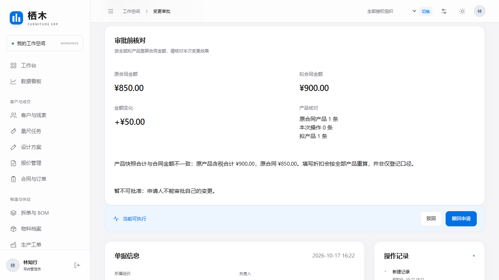

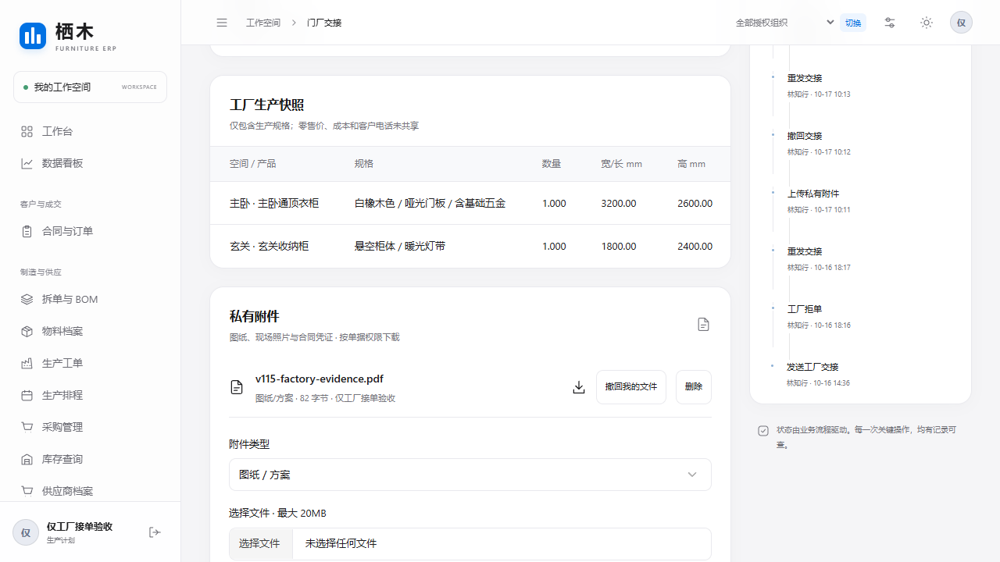

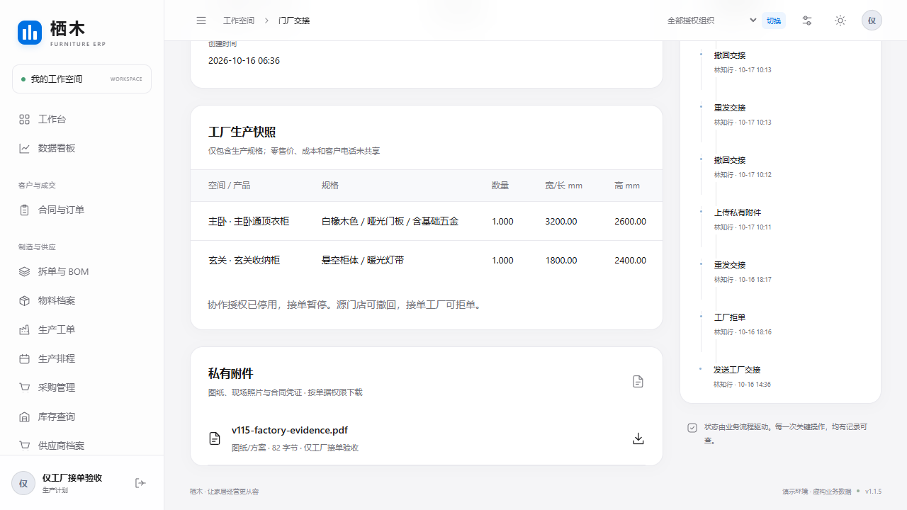

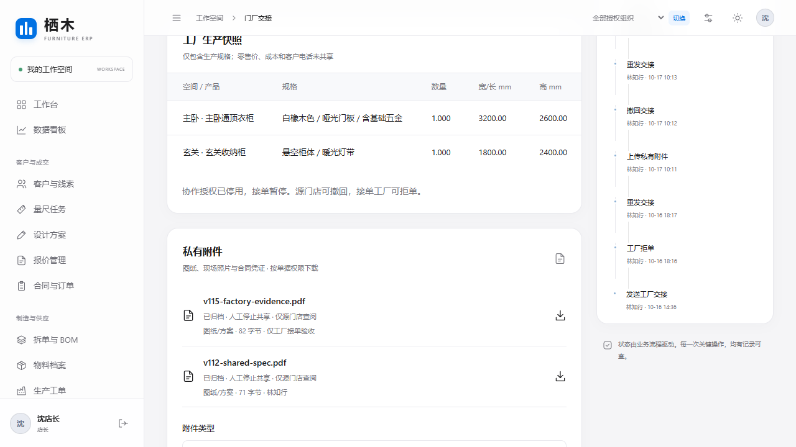

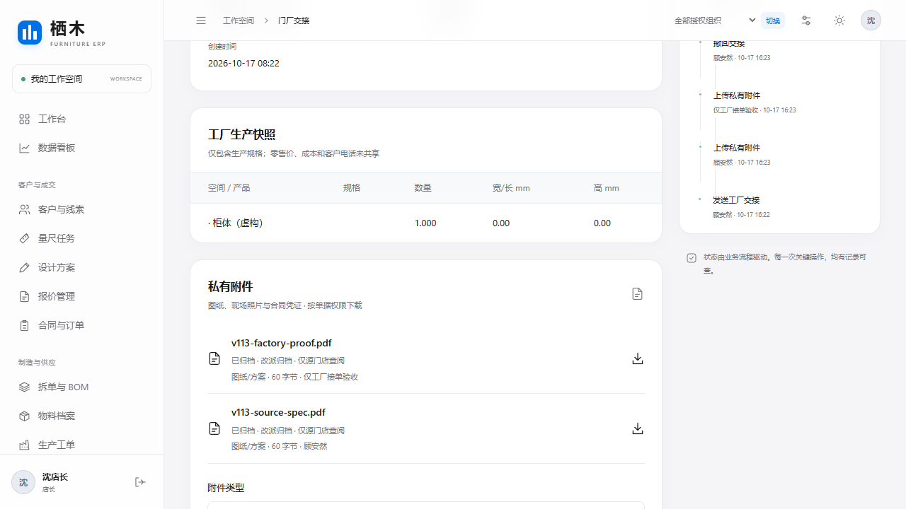

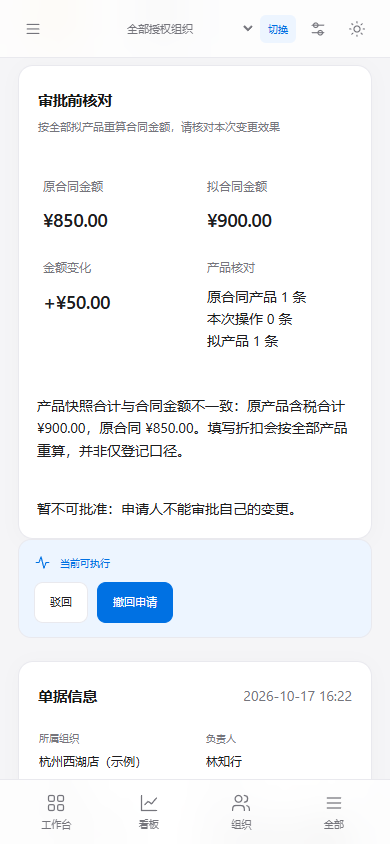

---

以下为前轮验证历史，数字与行为仅代表当时版本。

# 验证记录 · v1.1.4 五次评审修正

2026-10-17，最终功能提交 `2c65a65`。**147用例**：SQLite139通过/8个PG专用跳过；PostgreSQL146通过/1个SQLite备份专用跳过。Ubuntu/Windows×Python3.12/3.13和PostgreSQL16五组CI全绿，实际日志已核对：[运行日志](https://github.com/3578190277jqx/erp/actions/runs/39020960795)。原PR Checks跟踪后续文档和截图提交。

- 新增18个第五轮回归和1个PG竞争；原128用例、历史迁移和原7个PG竞争保持。来源篡改、批量POST、离职上传者、多角色范围、失效行逐一恢复、真实0与未知、正负差额均有覆盖。
- PG新竞争使用独立连接和事件：工厂先读旧附件元数据，源店提交停止共享，再进行版本确认；工厂最终PermissionDenied。原改派/读取竞争仍通过。
- 一次独立全变更审查发现多角色范围拼接、行操作修改后自批两项，均RED→GREEN修正；增加/移除行均计入最后编辑人，未留置已确认重要发现。
- 预升级SQLite与media备份保留在忽略目录，integrity_check=ok，0017实际应用。0017仅更改字段说明，不重写旧合同、文件及归档值。
- 系统check、迁移无漂移、collectstatic、生产check --deploy --fail-level WARNING通过。
- Chrome源店普通manager在交接已撤回时停止管理员上传的虚构PDF，原因与版本随确认提交，归档后源店下载200；同厂重发后工厂详情200、文件不在列表且下载403。DB确认archived_at非空、deleted_at为空、物理文件存在，交接sent/目标4。
- Chrome订单14新建变更：金额预填1000，订单与组织disabled；服务端篡改忽略由自动回归验证。待批列表无批量批准，伪造入口403由回归验证。
- Chrome虚构恢复样例订单15/申请9：A先删原产品令B两个引用SET_NULL；逐一移除2→1→0，剩一条时继续待核对且无批准入口。清完仍受订单旧版本限制，管理员编辑明确核对后由另一店长批准，最终0元/0产品，两次移除均有审计。未改既有真实业务凭证。
- Chrome390×844历史差异页显示850→900、+¥50.00，scrollWidth=390。主业务会话控制台0错误/0警告；目标厂验证拒绝下载产生预期403，不计为页面故障。

规则及边界见[U1–U6处理记录](V114_FIFTH_REVIEW_RESPONSE.md)。归档不自动恢复，已经下载或正在传输的副本无法收回；变更逐单核对，恢复后须明确编辑重新核对订单版本。

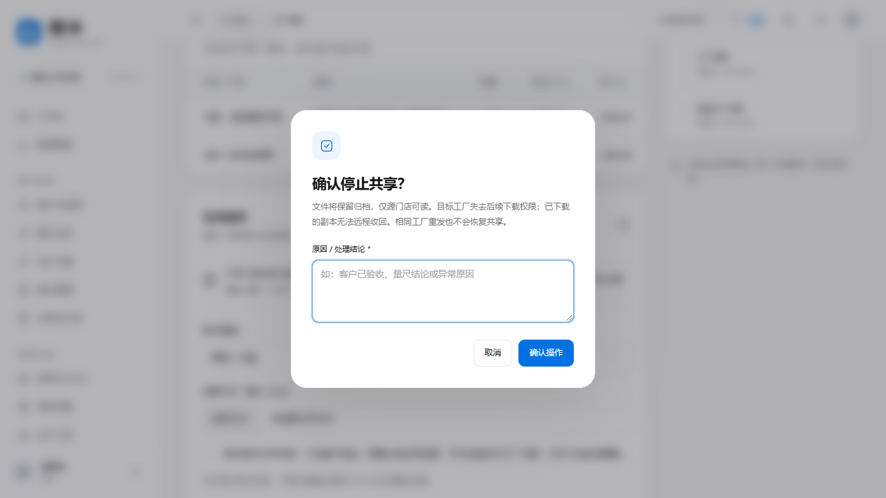

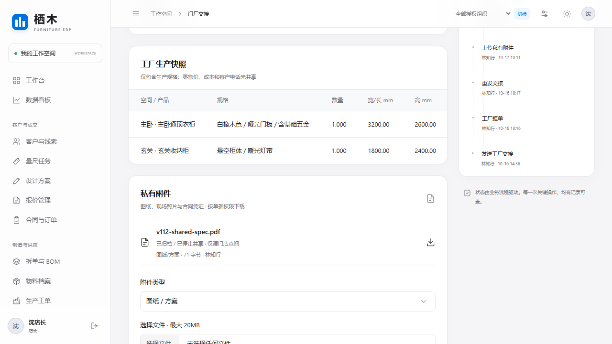

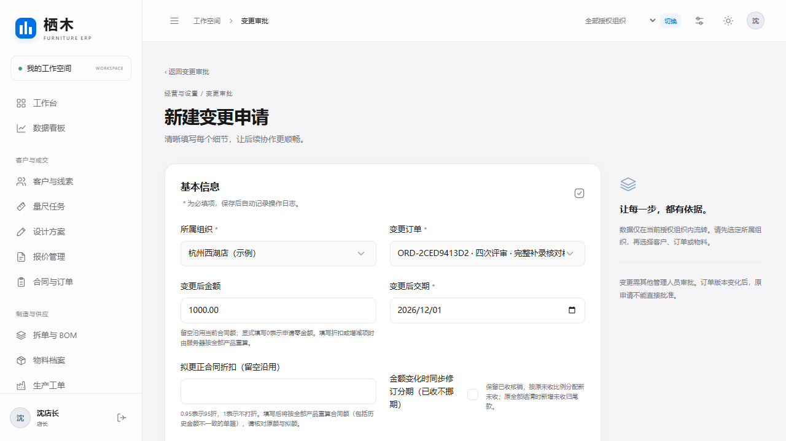

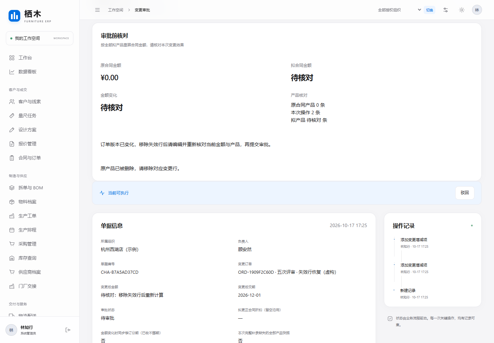

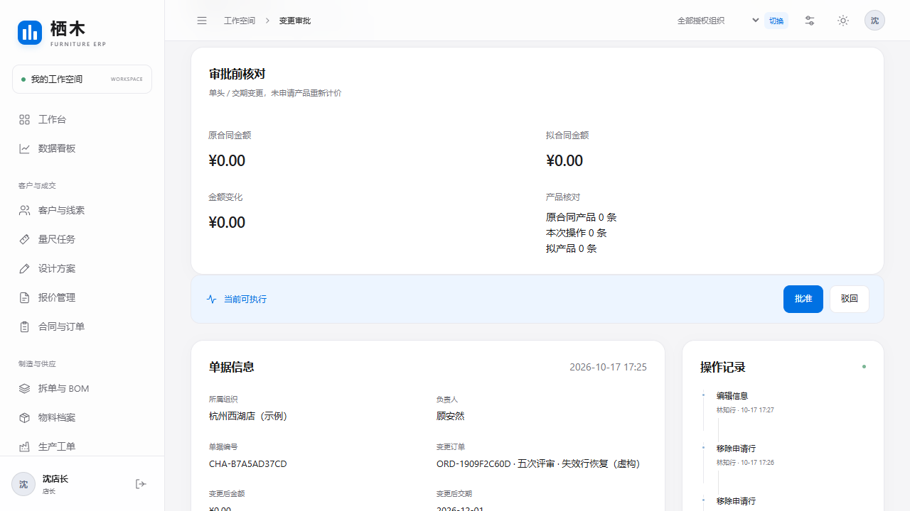

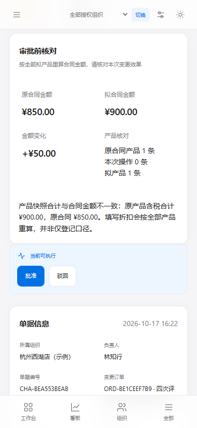

---

以下为前轮验证历史，数字与读取锁策略仅代表当时版本；当前读取策略以v1.1.4为准。

# 验证记录 · v1.1.3 四次评审修正

2026-10-17，功能提交 `128c512`。**128用例**：SQLite121通过/7个PG专用跳过；PostgreSQL127通过/1个SQLite备份专用跳过。Ubuntu/Windows×Python3.12/3.13和PostgreSQL16五组CI全绿：[运行日志](https://github.com/3578190277jqx/erp/actions/runs/39017457480)。后续文档提交以原PR Checks为准。

- 空字段缺失、空串、有/无产品、创建/编辑、未知口径仅改期、显式0、伪造派生总额都有回归。服务器准备函数共用于四个入口；审批验证不静默纠正存储值。
- 新增真实PG竞争：改派与新厂鉴权同时发生，旧厂文件不泄漏。原六类PG竞争保持；历史升级到0016验证旧文件名/版本/目标组织/合同额不改，归档字段为null。
- 独立审查发现草稿护栏提前、附件删除约束阻断改派两项，均RED→GREEN修正。首次额度中断未形成审查报告，有效重试完成一次只读审查；无第二次审查通过的虚构声明。
- 本机预升级SQLite及media备份保留在忽略目录，integrity_check=ok，0016实际应用。原密码、已批合同和付款凭证不重置。
- check、makemigrations无漂移、collectstatic及生产check --deploy --fail-level WARNING通过。
- Chrome新建申请清空金额、只改交期，拟额仍11676.79；另一店长批准，合同不变/交期2026-12-15，后两期日期同步，已收尾款100不动。
- Chrome历史差异样例：原合同850、产品900、拟折扣仍0.9，拟额900；详情及确认框明确850→900/+50。取消批准保留原合同850，供继续检查。
- Chrome门店与工厂各上传1个虚构PDF，各自只显示自己的删除按钮，工厂试图跨删门店文件POST403。
- Chrome源销售撤回后改派另一厂，无需删除工厂文件；旧两文件标记归档、deleted_at仍null、版本1→2、物理文件存在。源店下载归档200，新厂两个文件下载均403且列表为空；新厂接单成功，生产单total0、discount_confirmed=True。
- 孤立附件在锁定父单时查不到原单据，仍返回拒绝访问，不泄漏服务端错误；新增回归验证。
- Chrome完整补录实操显示原0条/本次1条/拟1条，保留人工完整性核对警告。
- 390×844审批比较页scrollWidth=390；主业务页控制台0错误/0警告。样例与截图均不含真实客户数据。

规则、处置矩阵及保留边界见 [S1–S6记录](V113_FOURTH_REVIEW_RESPONSE.md)。旧零额申请不猜意图；完整补录须人工核对；归档保持源店可读，需与media配套备份。

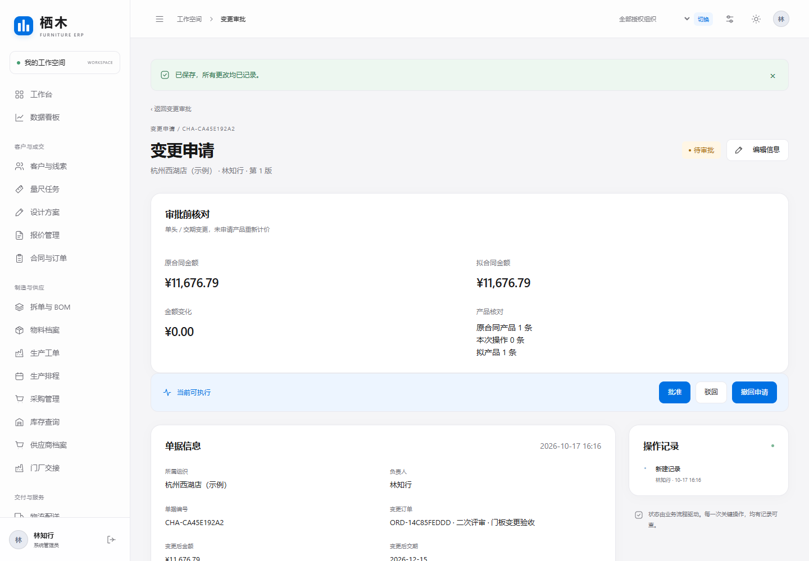

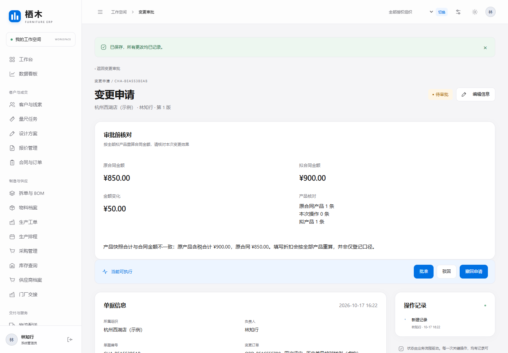

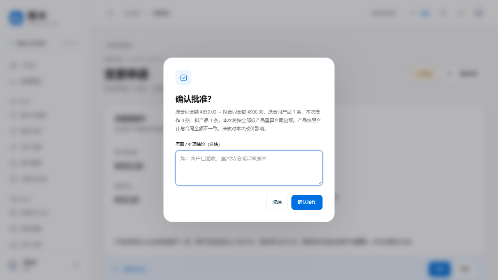

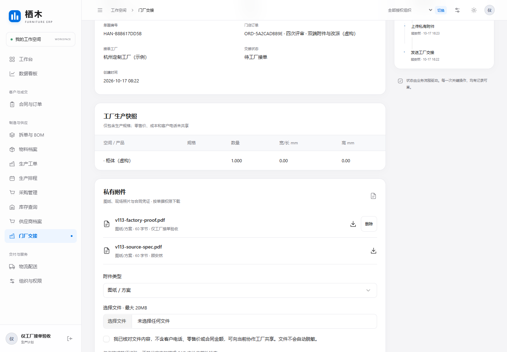

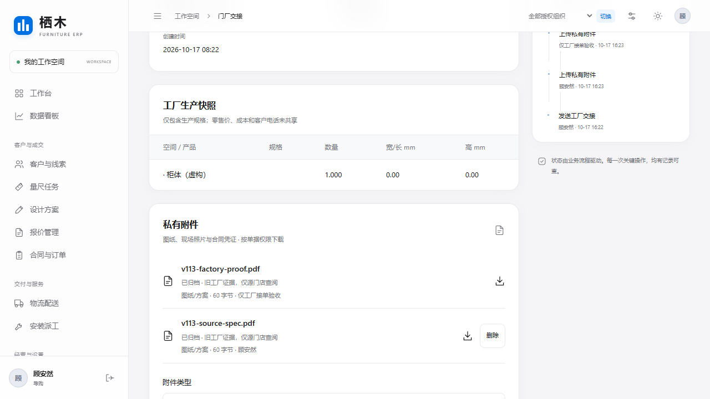

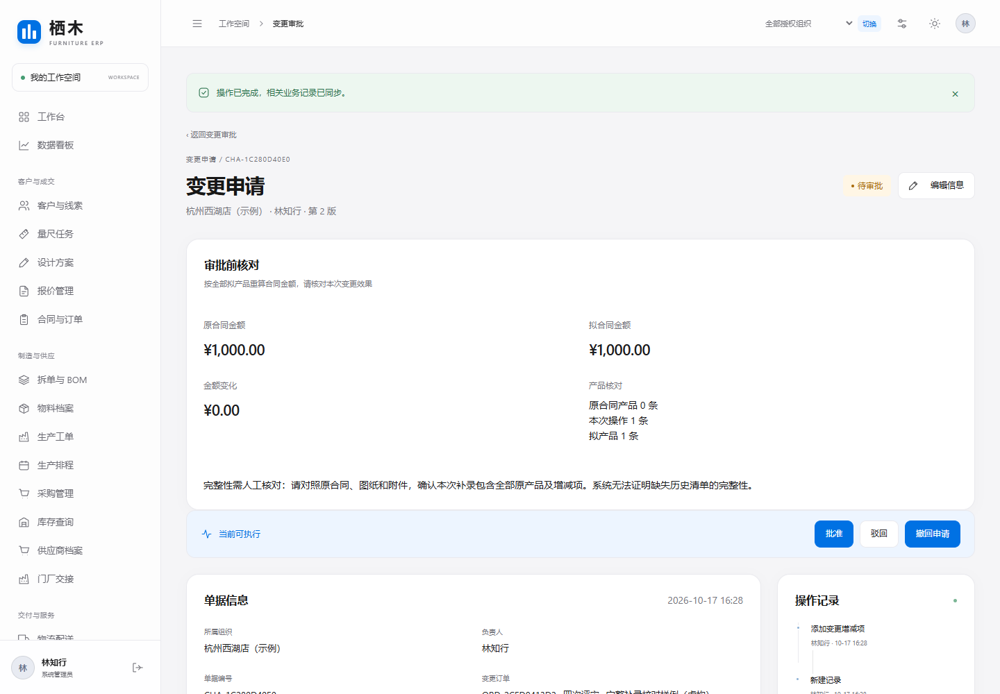

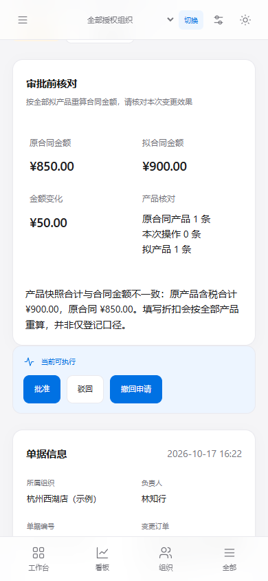

---

以下为前轮验证历史，数字与范围仅代表当时版本。

# 验证记录 · v1.1.2 三次评审修正

2026-10-17，提交 `6b0c375`。**111个用例**：SQLite105通过/6个PG专用跳过；PostgreSQL110通过/1个SQLite备份专用跳过。Ubuntu/Windows × Python3.12/3.13及PostgreSQL16五组CI全部成功：[运行日志](https://github.com/3578190277jqx/erp/actions/runs/38994189997)。最新提交的额外资源版本号和截图以原PR检查为准。

- 新增PG竞争：工厂接单与源门店撤回仅一个提交；收款700与合同减至600的批准仅一个提交，计划合计始终等于合同且收款不超过合同。
- 原4个PG竞争、历史0002/0007→0015迁移、SQLite备份、组织和本人范围、附件失权与大文件分块回归均保留。历史有报价口径已知、无报价销售口径未知，不重算历史金额。
- 独立审查发现未知金额绕过、迟到上传跨厂、回传反向锁序三项，均先写失败回归再修复；另补上重发附件检查提醒，无待处理的重要发现。
- 本地先备份SQLite与media至忽略目录，integrity_check=ok，0013–0015在现有演示库成功应用，不重置密码。seed_upgrade_demo重复执行保持原数据。
- check、makemigrations无漂移、collectstatic、生产check --deploy --fail-level WARNING均通过。
- Chrome真实新建折扣0.9变更并留空金额，服务器计算11676.79；另一店长批准成功，来源报价仍为0.95/12325.50。产品净额10333.44、税1343.35。
- 三期新应收3501.45/4668.59/3506.75，原尾款100保持第三期；定金与生产款已收仍0；新交期2026-12-01同步后两期日期。
- 真实上传交接测试PDF，确认脱敏并绑定目标/版本。仅有工厂角色账号下载：待接单200→撤回403→重发200→再撤回403；撤回时详情404。兼有源门店权限的账号仍按源权限读取，符合独立授权语义。
- 浏览器源门店撤回待接单交接后显示重发入口；原编号不变版本递增。真实申请人撤回旧待批申请，状态已撤回。
- 390×844手机订单scrollWidth=390，无整页横向溢出；主业务页控制台0错误/0警告。共享确认checkbox与说明同行，静态CSS/JS加版本号确保升级浏览器取得新交互。

规则与保留范围见 [R1–R10记录](V112_THIRD_REVIEW_RESPONSE.md)。分期只重分未收，已收不挪期；全部结清后新增未收归尾款。工程师查看与工厂接单继续分工；越权对象404继续保留。

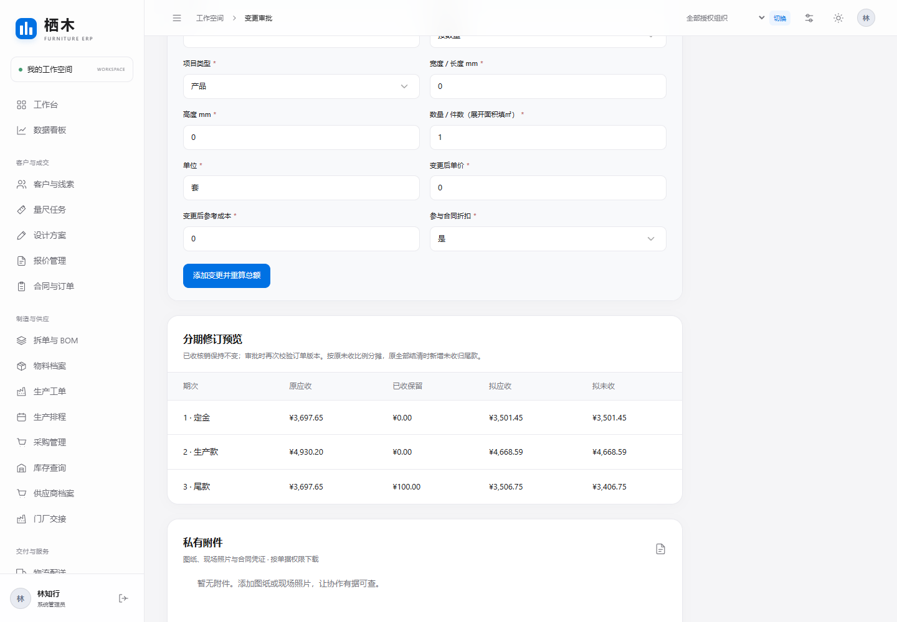

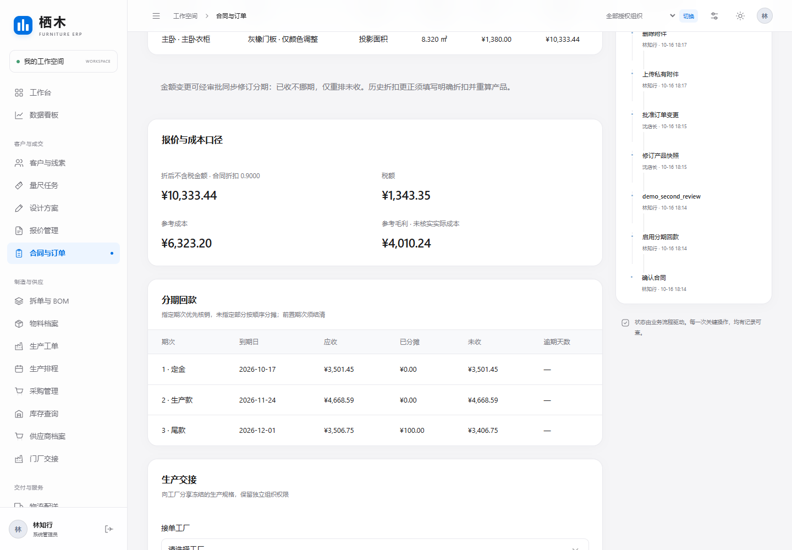

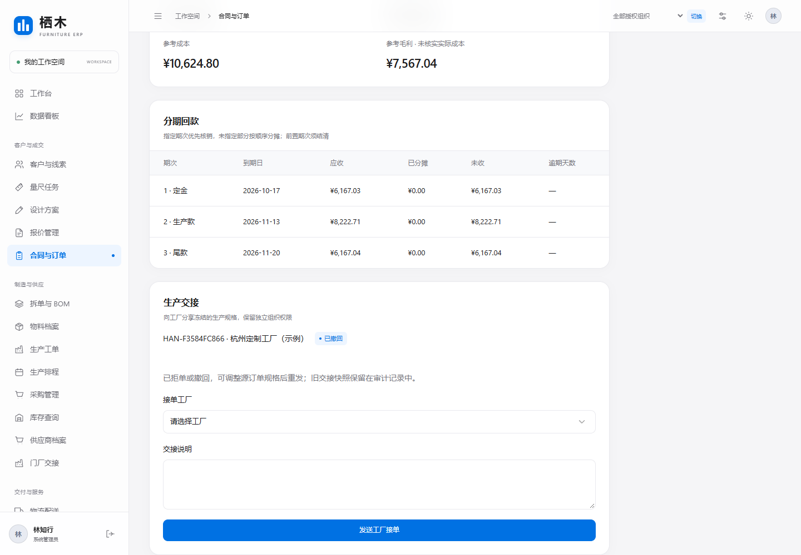

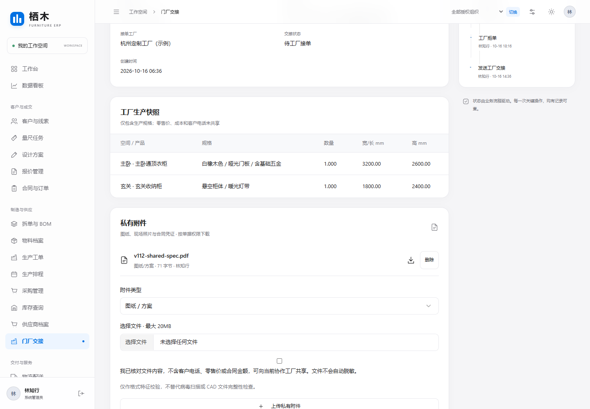

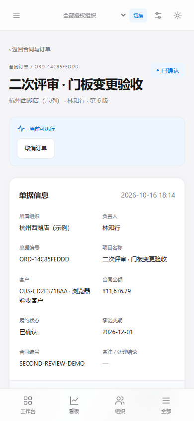

---

以下为前轮验证历史，数字与范围仅代表当时版本。

# 验证记录 · v1.1.1 二次评审修正

2026-10-16，最终功能提交 `06069e0`。**89用例**：SQLite85通过/4个PG专用跳过，PostgreSQL88通过/1个SQLite备份专用跳过。Ubuntu/Windows × Python3.12/3.13及PostgreSQL16共五组CI全绿：[运行日志](https://github.com/3578190277jqx/erp/actions/runs/38886809316)。

- 新增4种真实PG竞争检查：双工单抢料、并发收款防超额、订单取消与BOM释放、同变更重复审批。使用独立连接与屏障同步，校验最终业务状态和审计，线程结束显式关连接。
- 0002→最新及0007→最新历史迁移测试通过：合同额与已批记录不重算，旧待批增减项保留并转驳回待核对，内部占位记录不删除，工厂订单归并，协作授权不从旧发送记录推断，旧行净额快照保持空值。
- 独立审查及增量复核发现零折扣下限、历史金额展示两项，均先写失败回归再修复；最后复核无新增已确认阻断问题。
- 本地升级前备份SQLite并通过integrity_check；私有media复制至忽略的备份目录。0008–0012在现有演示库实际迁移成功，账号密码未重置。
- `check`、迁移无漂移、静态收集、生产`check --deploy --fail-level WARNING`通过。
- Chrome真实填写修改项：3200×2600mm、8.32㎡、0.95合同折扣，只改颜色后总额仍¥12,325.50，行净额¥10,907.52；另一管理人员审批成功。
- Chrome指定尾款实收¥100，订单显示尾款已收100、定金仍0；收款通过确认弹窗后实际持久化。
- Chrome工厂拒单→订单重发，交接单编号不变且版本由1→2→3，状态回待接单。
- Chrome上传新测试附件→确认删除，页面链接消失、下载403、purged_at记录且物理文件不存在。
- 390×844移动订单scrollWidth=390，无全页横向溢出。主页面资源本地加载，无新增JS运行时错误。

处理矩阵、管理员必需配置与后续范围见 [N1–N18记录](V111_SECOND_REVIEW_RESPONSE.md)。管理员须显式启用门店→工厂协作授权；默认不改变存量组织的可选分期政策。旧已审批变更没有可靠净额快照时，界面指向历史审计，不显示新规则重算金额。

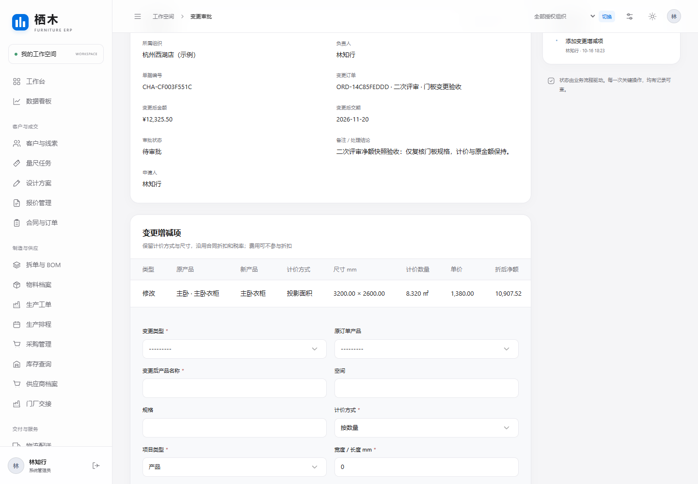

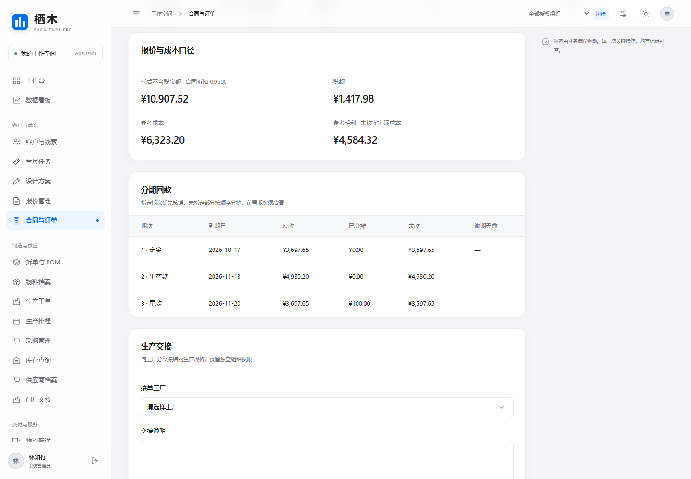

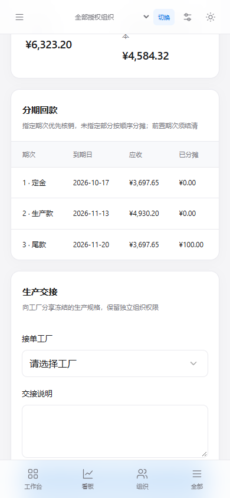

---

以下为前轮验证历史，数字与范围仅代表当时版本。

# 验证记录 · v1.1

日期：2026-10-16。本地 Windows、Python 3.13、SQLite；GitHub Actions 使用 Ubuntu / Windows 及 PostgreSQL 16。

## 自动化与升级

- 65 个回归用例：SQLite 本地 64 通过，1 个真实 PostgreSQL 并发用例按后端跳过。
- 覆盖行业计价/税额/参考成本、订单快照独立性、增减项金额篡改与历史审计、附件格式/大小/登录/重分配后权限、工厂隔离及冻结保护、库存预留与换仓限制、分批超收回滚、分期尾差/草稿限制、导入原子性、完整任务计数、SQL 全范围余额、请求权限查询和在线备份。
- 历史迁移测试从 `0002` 建立旧订单、报价、已收采购和设计后升级到 `0007`：合同额850保持不变，来源报价快照900保留，旧采购已收10回填为10且不新增库存流水，旧设计各有独立系列。
- 本地现有数据库先在线备份至忽略目录 `output/backups/`，完整性检查为 `ok`，随后 `0003`–`0007` 实际升级成功。未重置原业务数据或密码。
- `check`、`makemigrations --check --dry-run`、`collectstatic --noinput`、生产 `check --deploy --fail-level WARNING` 均通过。
- PostgreSQL CI 执行实际迁移、业务用例、历史升级用例和双工单并发争抢：10份库存、两工单各需6，必须只有一单预留成功，现存10/预留6。
- SQLite 备份测试在独立文件中备份并恢复读取中文数据，验证完整性及拒绝覆盖。此测试在 PostgreSQL 作业跳过；PostgreSQL 备份与实际灾难恢复未验收。

- 最终功能提交 `ac5f1a9` 的5组 CI 全部成功：[完整日志](https://github.com/3578190277jqx/erp/actions/runs/38863136180)。PostgreSQL 作业65例中64通过，1例跳过SQLite专用备份；四组SQLite作业各64通过，1例跳过PG专用并发。
- CI曾暴露并修复测试生命周期问题：并发线程结束须真正关闭连接；流式下载迭代器已自动关闭测试请求，不能再次手工关闭而破坏TestCase事务。修复后完整PG作业成功。

## 浏览器实证

使用 Chrome 与 Playwright CLI，所有业务页面资源来自本地：

| 操作 | 结果 |
|---|---|
| 1440×1000 订单详情 | 产品快照、税额、参考毛利、分期及交接清晰显示 |
| 390×844 手机订单详情 | 页面 scrollWidth=390，与 viewport=390 相同，明细容器单独滚动 |
| 上传并下载私有 PDF | 真实 multipart 上传、鉴权下载；下载后 SHA256 与源文件完全一致 |
| 库存列表 | 现存/已预留/可用列及采购剩余在途可见 |
| 订单打印 | 专用打印版、折后净额/含税总额，浏览器 PDF 导出成功 |
| 静态资源 | 主业务页面控制台0错误/0警告；打印页缺 favicon 的404已补图标并复查 |
| 演示升级 | 幂等追加行业报价、分期、待接单交接、40/100已收采购、供应商与跟进；旧密码不变 |

最新版预览使用原端口 `http://127.0.0.1:8000`。`output/` 中保留本机浏览器证据及PDF，不提交业务文件或凭证。

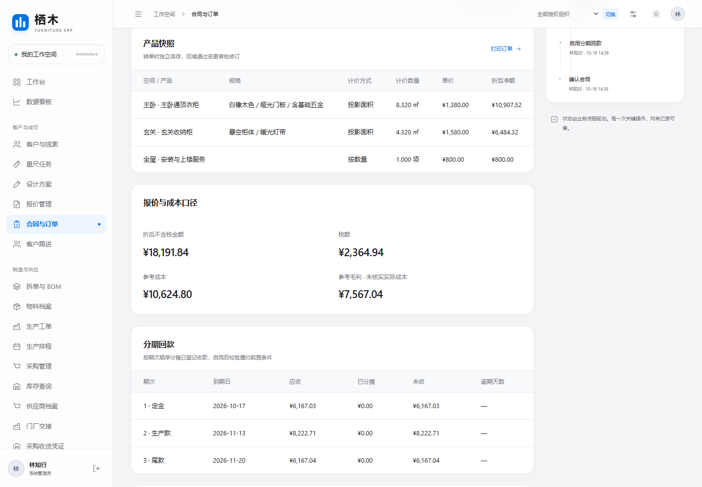

## 独立审查

只读全量复核及最后增量复核已完成。发现以下问题后先加失败测试再修复：

1. 预留后换仓遗留原仓占用：必须先释放预留才能更换仓库，并统一父订单→工单锁顺序。
2. 草稿提前建分期、后改合同金额：仅已确认销售订单可启用；履约时另校验分期合计等于合同额。
3. 供应商建成后不能编辑：修复主数据可编辑判断。

额外保护：变更审批重算增减项，保留产品修改前后值；已交接产品不能单边修订，工厂订单不能单边取消；工厂开工检查源订单定金。复核在隔离库实跑工厂开工/完工到源订单进度回传。最后增量未发现新增已确认阻断问题。

## 本轮边界

详细逐项状态见 [33项评审采纳记录](V11_REVIEW_RESPONSE.md)。基础并发用例通过不代表容量压测或正式上线验收。未实测 Docker 镜像构建、PostgreSQL 灾难恢复、大规模数据压力、原生移动端、CAD/设备/银行集成。附件备份需与数据库另行配套；收款计划调整、交接后的改派/撤回及销售退货退款仍需专题实现。

---

以下保留首次版本的验证历史；与 v1.1 不同的“未实现”描述仅适用于当时版本。

# v1.0 历史验证记录

日期：2026-10-16。本地环境 Windows、Python 3.13、SQLite。

## 自动化

- `python manage.py test --verbosity 1`：**40 项通过**。覆盖权限范围、数据验证、报价转单、制造交付、库存和财务事务、HTTP 界面、演示初始化与独立审查回归。
- `python manage.py check`：无问题。
- `python manage.py makemigrations --check --dry-run`：无迁移漂移。
- `python manage.py collectstatic --noinput`：成功；Tabler CSS 与应用 CSS/JS/SVG 均本地托管。
- `DJANGO_DEBUG=false` 并配置临时随机密钥与正式域名后，`python manage.py check --deploy --fail-level WARNING`：无警告。
- `python scripts/start.py --demo --port 8001`：从未创建的项目 `.venv` 完成安装、迁移、静态收集、幂等演示初始化并启动。默认端口 8000 由主预览服务使用。
- GitHub CI：功能修复提交 `010db64` 的 Ubuntu / Windows × Python 3.12 / 3.13 四组合检查全部通过；[查看完整运行日志](https://github.com/3578190277jqx/erp/actions/runs/38858289998)。

## 浏览器

Chrome + Playwright 真实浏览器验证：

| 检查 | 结果 |
|---|---|
| 1440 × 1000 桌面登录和工作台 | 成功登录，真实指标及任务正常 |
| 浅色 / 深色切换 | 生效，跨页面保留主题 |
| 390 × 844 移动工作台 | 页面 scrollWidth=390，viewport=390，无全页横向溢出 |
| 移动订单列表 | 页面宽 390，965px 表格在自己的容器内横向滚动 |
| 抽屉导航 / Esc 关闭 | 正常 |
| 新建客户 | 实际填写姓名、电话与地址，保存后跳转详情，数据库持久化 |
| 状态确认弹窗 | 实际填写跟进结论并提交，状态变为“跟进中”，版本与审计更新 |
| 看板拖拽 | 将生产卡片拖到合法下一状态，打开对应确认弹窗；取消不改业务数据 |
| 浏览器控制台 | 应用错误 0、警告 0 |

截图：

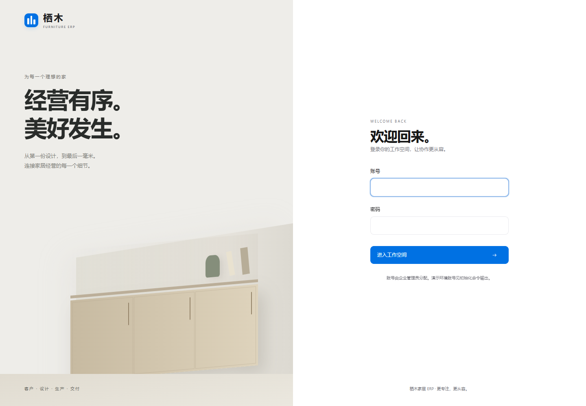

## 独立审查与修复

独立审查后补充回归测试，并验证先失败、修复后通过：

1. 现场人员已分配任务的客户/订单关联只读授权；不能因此编辑关联订单或访问无关客户。
2. 进行中的量尺可补填面积和结论，再提交完成，避免现场任务卡死。
3. 变更申请单独记录真实申请人，改负责人不能绕过本人不得审批；最近编辑人也不能批准自己编辑的申请。
4. HTTPS 代理使用 Waitress 显式可信节点 IP；真实进程测试从 301 循环失败变为 200。未授权代理头不作为信任依据。
5. 订单取消与履约操作统一先锁父订单；已取消订单不能被工单开工重新激活。
6. 将“只读交易详情缺少字段”提升为必须修复：库存、收付款、流水和审计详情展示业务字段、凭证和前后值。

## 实施决定

- 使用新拉取仓库的 `feat/furniture-erp` 分支，保留原始 main 和初始提交，未另建 worktree。
- 使用 WhiteNoise 压缩静态存储；无需已有 manifest 才能跑单测，正式启动仍收集静态资源。
- 采购员提交及下单，店长/老板审批；确认了文档原矩阵中的矛盾。
- 本人范围的现场岗位获得已分配任务的父级客户/订单**只读**关联，动作仍仅在自己的任务执行。
- 套裁、自动优化、法定总账、部分收货/退款、跨组织正式交接不在首版范围；方案明确列为后续确认事项，未伪装成已实现接口。

## 环境限制

当前未安装 Docker / PostgreSQL。提供部署配置，但容器构建、PostgreSQL 压力及并发竞态没有在本机实测；父订单锁顺序经代码审查，取消后开工的保护有 SQLite 回归。未发布公网服务，也未接入真实客户数据、支付、税务或硬件。
