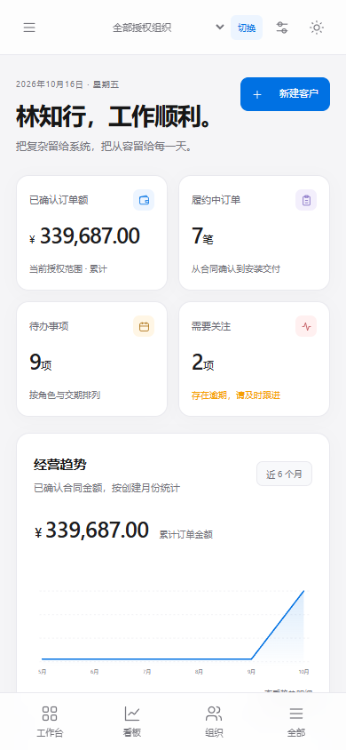

# 验证记录

日期：2026-10-16。本地环境 Windows、Python 3.13、SQLite。

## 自动化

- `python manage.py test --verbosity 1`：**40 项通过**。覆盖权限范围、数据验证、报价转单、制造交付、库存和财务事务、HTTP 界面、演示初始化与独立审查回归。
- `python manage.py check`：无问题。
- `python manage.py makemigrations --check --dry-run`：无迁移漂移。
- `python manage.py collectstatic --noinput`：成功；Tabler CSS 与应用 CSS/JS/SVG 均本地托管。
- `DJANGO_DEBUG=false` 并配置临时随机密钥与正式域名后，`python manage.py check --deploy --fail-level WARNING`：无警告。
- `python scripts/start.py --demo --port 8001`：从未创建的项目 `.venv` 完成安装、迁移、静态收集、幂等演示初始化并启动。默认端口 8000 由主预览服务使用。
- GitHub CI：功能修复提交 `010db64` 的 Ubuntu / Windows × Python 3.12 / 3.13 四组合检查全部通过；[查看完整运行日志](https://github.com/3578190277jqx/erp/actions/runs/38858289998)。

## 浏览器

Chrome + Playwright 真实浏览器验证：

| 检查 | 结果 |
|---|---|
| 1440 × 1000 桌面登录和工作台 | 成功登录，真实指标及任务正常 |
| 浅色 / 深色切换 | 生效，跨页面保留主题 |
| 390 × 844 移动工作台 | 页面 scrollWidth=390，viewport=390，无全页横向溢出 |
| 移动订单列表 | 页面宽 390，965px 表格在自己的容器内横向滚动 |
| 抽屉导航 / Esc 关闭 | 正常 |
| 新建客户 | 实际填写姓名、电话与地址，保存后跳转详情，数据库持久化 |
| 状态确认弹窗 | 实际填写跟进结论并提交，状态变为“跟进中”，版本与审计更新 |
| 看板拖拽 | 将生产卡片拖到合法下一状态，打开对应确认弹窗；取消不改业务数据 |
| 浏览器控制台 | 应用错误 0、警告 0 |

截图：

## 独立审查与修复

独立审查后补充回归测试，并验证先失败、修复后通过：

1. 现场人员已分配任务的客户/订单关联只读授权；不能因此编辑关联订单或访问无关客户。
2. 进行中的量尺可补填面积和结论，再提交完成，避免现场任务卡死。
3. 变更申请单独记录真实申请人，改负责人不能绕过本人不得审批；最近编辑人也不能批准自己编辑的申请。
4. HTTPS 代理使用 Waitress 显式可信节点 IP；真实进程测试从 301 循环失败变为 200。未授权代理头不作为信任依据。
5. 订单取消与履约操作统一先锁父订单；已取消订单不能被工单开工重新激活。
6. 将“只读交易详情缺少字段”提升为必须修复：库存、收付款、流水和审计详情展示业务字段、凭证和前后值。

## 实施决定

- 使用新拉取仓库的 `feat/furniture-erp` 分支，保留原始 main 和初始提交，未另建 worktree。
- 使用 WhiteNoise 压缩静态存储；无需已有 manifest 才能跑单测，正式启动仍收集静态资源。
- 采购员提交及下单，店长/老板审批；确认了文档原矩阵中的矛盾。
- 本人范围的现场岗位获得已分配任务的父级客户/订单**只读**关联，动作仍仅在自己的任务执行。
- 套裁、自动优化、法定总账、部分收货/退款、跨组织正式交接不在首版范围；方案明确列为后续确认事项，未伪装成已实现接口。

## 环境限制

当前未安装 Docker / PostgreSQL。提供部署配置，但容器构建、PostgreSQL 压力及并发竞态没有在本机实测；父订单锁顺序经代码审查，取消后开工的保护有 SQLite 回归。未发布公网服务，也未接入真实客户数据、支付、税务或硬件。
