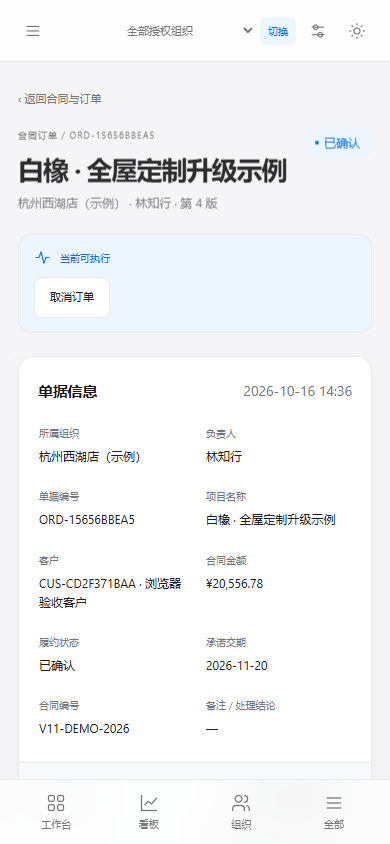
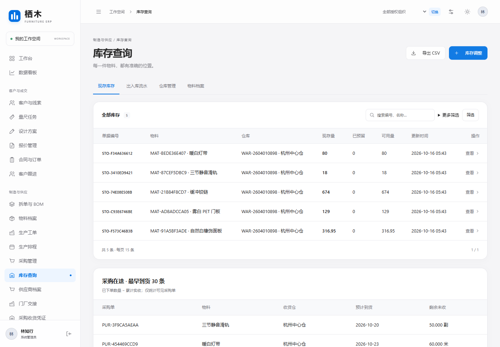
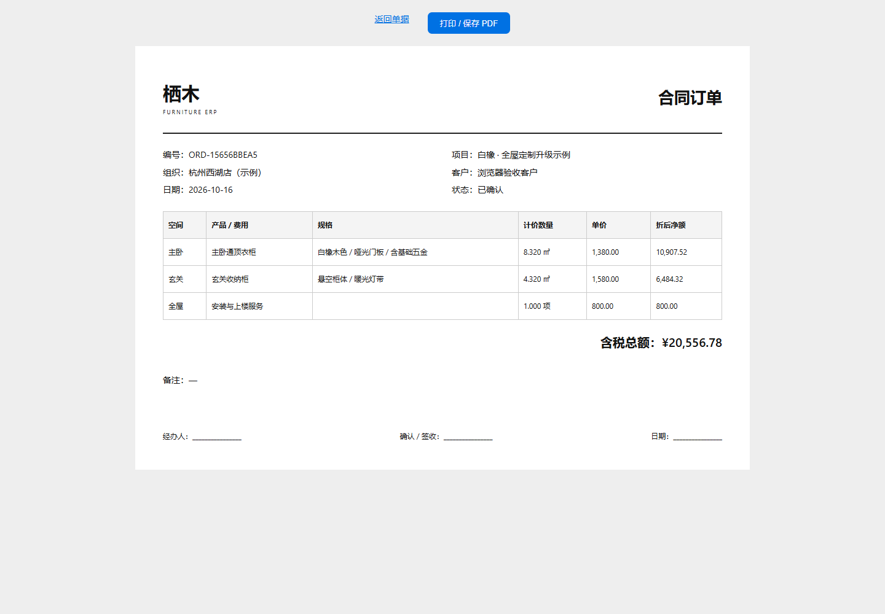
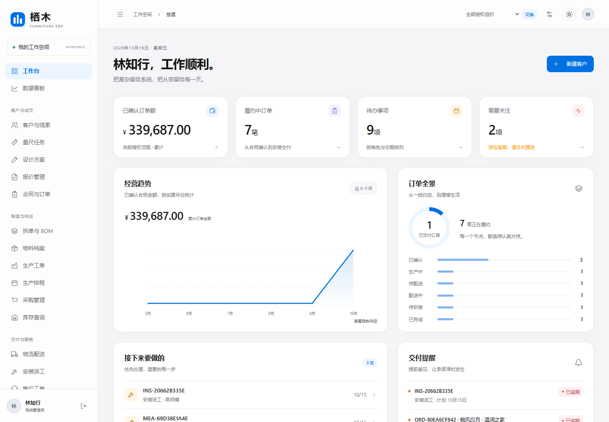
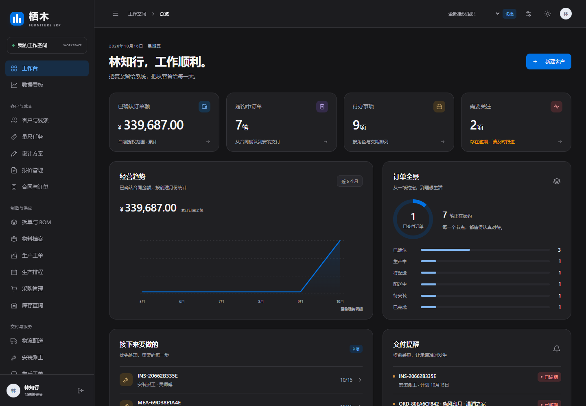

# 验证记录 · v1.1

日期：2026-10-16。本地 Windows、Python 3.13、SQLite；GitHub Actions 使用 Ubuntu / Windows 及 PostgreSQL 16。

## 自动化与升级

- 65 个回归用例：SQLite 本地 64 通过，1 个真实 PostgreSQL 并发用例按后端跳过。
- 覆盖行业计价/税额/参考成本、订单快照独立性、增减项金额篡改与历史审计、附件格式/大小/登录/重分配后权限、工厂隔离及冻结保护、库存预留与换仓限制、分批超收回滚、分期尾差/草稿限制、导入原子性、完整任务计数、SQL 全范围余额、请求权限查询和在线备份。
- 历史迁移测试从 `0002` 建立旧订单、报价、已收采购和设计后升级到 `0007`：合同额850保持不变，来源报价快照900保留，旧采购已收10回填为10且不新增库存流水，旧设计各有独立系列。
- 本地现有数据库先在线备份至忽略目录 `output/backups/`，完整性检查为 `ok`，随后 `0003`–`0007` 实际升级成功。未重置原业务数据或密码。
- `check`、`makemigrations --check --dry-run`、`collectstatic --noinput`、生产 `check --deploy --fail-level WARNING` 均通过。
- PostgreSQL CI 执行实际迁移、业务用例、历史升级用例和双工单并发争抢：10份库存、两工单各需6，必须只有一单预留成功，现存10/预留6。
- SQLite 备份测试在独立文件中备份并恢复读取中文数据，验证完整性及拒绝覆盖。此测试在 PostgreSQL 作业跳过；PostgreSQL 备份与实际灾难恢复未验收。

- 最终功能提交 `ac5f1a9` 的5组 CI 全部成功：[完整日志](https://github.com/3578190277jqx/erp/actions/runs/38863136180)。PostgreSQL 作业65例中64通过，1例跳过SQLite专用备份；四组SQLite作业各64通过，1例跳过PG专用并发。
- CI曾暴露并修复测试生命周期问题：并发线程结束须真正关闭连接；流式下载迭代器已自动关闭测试请求，不能再次手工关闭而破坏TestCase事务。修复后完整PG作业成功。

## 浏览器实证

使用 Chrome 与 Playwright CLI，所有业务页面资源来自本地：

| 操作 | 结果 |
|---|---|
| 1440×1000 订单详情 | 产品快照、税额、参考毛利、分期及交接清晰显示 |
| 390×844 手机订单详情 | 页面 scrollWidth=390，与 viewport=390 相同，明细容器单独滚动 |
| 上传并下载私有 PDF | 真实 multipart 上传、鉴权下载；下载后 SHA256 与源文件完全一致 |
| 库存列表 | 现存/已预留/可用列及采购剩余在途可见 |
| 订单打印 | 专用打印版、折后净额/含税总额，浏览器 PDF 导出成功 |
| 静态资源 | 主业务页面控制台0错误/0警告；打印页缺 favicon 的404已补图标并复查 |
| 演示升级 | 幂等追加行业报价、分期、待接单交接、40/100已收采购、供应商与跟进；旧密码不变 |

最新版预览使用原端口 `http://127.0.0.1:8000`。`output/` 中保留本机浏览器证据及PDF，不提交业务文件或凭证。

## 独立审查

只读全量复核及最后增量复核已完成。发现以下问题后先加失败测试再修复：

1. 预留后换仓遗留原仓占用：必须先释放预留才能更换仓库，并统一父订单→工单锁顺序。
2. 草稿提前建分期、后改合同金额：仅已确认销售订单可启用；履约时另校验分期合计等于合同额。
3. 供应商建成后不能编辑：修复主数据可编辑判断。

额外保护：变更审批重算增减项，保留产品修改前后值；已交接产品不能单边修订，工厂订单不能单边取消；工厂开工检查源订单定金。复核在隔离库实跑工厂开工/完工到源订单进度回传。最后增量未发现新增已确认阻断问题。

## 本轮边界

详细逐项状态见 [33项评审采纳记录](V11_REVIEW_RESPONSE.md)。基础并发用例通过不代表容量压测或正式上线验收。未实测 Docker 镜像构建、PostgreSQL 灾难恢复、大规模数据压力、原生移动端、CAD/设备/银行集成。附件备份需与数据库另行配套；收款计划调整、交接后的改派/撤回及销售退货退款仍需专题实现。

---

以下保留首次版本的验证历史；与 v1.1 不同的“未实现”描述仅适用于当时版本。

# v1.0 历史验证记录

日期：2026-10-16。本地环境 Windows、Python 3.13、SQLite。

## 自动化

- `python manage.py test --verbosity 1`：**40 项通过**。覆盖权限范围、数据验证、报价转单、制造交付、库存和财务事务、HTTP 界面、演示初始化与独立审查回归。
- `python manage.py check`：无问题。
- `python manage.py makemigrations --check --dry-run`：无迁移漂移。
- `python manage.py collectstatic --noinput`：成功；Tabler CSS 与应用 CSS/JS/SVG 均本地托管。
- `DJANGO_DEBUG=false` 并配置临时随机密钥与正式域名后，`python manage.py check --deploy --fail-level WARNING`：无警告。
- `python scripts/start.py --demo --port 8001`：从未创建的项目 `.venv` 完成安装、迁移、静态收集、幂等演示初始化并启动。默认端口 8000 由主预览服务使用。
- GitHub CI：功能修复提交 `010db64` 的 Ubuntu / Windows × Python 3.12 / 3.13 四组合检查全部通过；[查看完整运行日志](https://github.com/3578190277jqx/erp/actions/runs/38858289998)。

## 浏览器

Chrome + Playwright 真实浏览器验证：

| 检查 | 结果 |
|---|---|
| 1440 × 1000 桌面登录和工作台 | 成功登录，真实指标及任务正常 |
| 浅色 / 深色切换 | 生效，跨页面保留主题 |
| 390 × 844 移动工作台 | 页面 scrollWidth=390，viewport=390，无全页横向溢出 |
| 移动订单列表 | 页面宽 390，965px 表格在自己的容器内横向滚动 |
| 抽屉导航 / Esc 关闭 | 正常 |
| 新建客户 | 实际填写姓名、电话与地址，保存后跳转详情，数据库持久化 |
| 状态确认弹窗 | 实际填写跟进结论并提交，状态变为“跟进中”，版本与审计更新 |
| 看板拖拽 | 将生产卡片拖到合法下一状态，打开对应确认弹窗；取消不改业务数据 |
| 浏览器控制台 | 应用错误 0、警告 0 |

截图：

## 独立审查与修复

独立审查后补充回归测试，并验证先失败、修复后通过：

1. 现场人员已分配任务的客户/订单关联只读授权；不能因此编辑关联订单或访问无关客户。
2. 进行中的量尺可补填面积和结论，再提交完成，避免现场任务卡死。
3. 变更申请单独记录真实申请人，改负责人不能绕过本人不得审批；最近编辑人也不能批准自己编辑的申请。
4. HTTPS 代理使用 Waitress 显式可信节点 IP；真实进程测试从 301 循环失败变为 200。未授权代理头不作为信任依据。
5. 订单取消与履约操作统一先锁父订单；已取消订单不能被工单开工重新激活。
6. 将“只读交易详情缺少字段”提升为必须修复：库存、收付款、流水和审计详情展示业务字段、凭证和前后值。

## 实施决定

- 使用新拉取仓库的 `feat/furniture-erp` 分支，保留原始 main 和初始提交，未另建 worktree。
- 使用 WhiteNoise 压缩静态存储；无需已有 manifest 才能跑单测，正式启动仍收集静态资源。
- 采购员提交及下单，店长/老板审批；确认了文档原矩阵中的矛盾。
- 本人范围的现场岗位获得已分配任务的父级客户/订单**只读**关联，动作仍仅在自己的任务执行。
- 套裁、自动优化、法定总账、部分收货/退款、跨组织正式交接不在首版范围；方案明确列为后续确认事项，未伪装成已实现接口。

## 环境限制

当前未安装 Docker / PostgreSQL。提供部署配置，但容器构建、PostgreSQL 压力及并发竞态没有在本机实测；父订单锁顺序经代码审查，取消后开工的保护有 SQLite 回归。未发布公网服务，也未接入真实客户数据、支付、税务或硬件。
