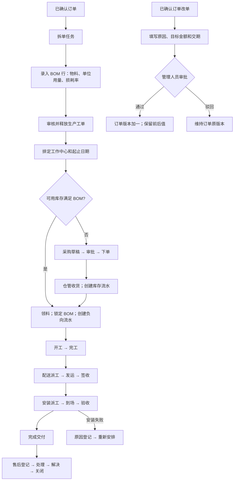
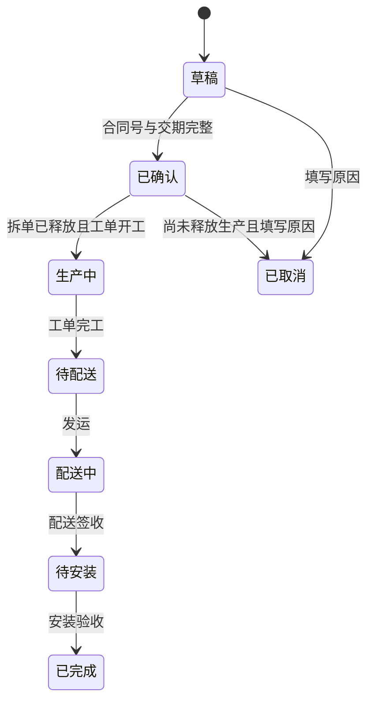

# 家居行业 ERP 交互设计项目方案 v1.0

项目：栖木家居 ERP。日期：2026-10-16。客户名称尚未提供，使用虚构示例数据，不代表真实客户经营数据。

## 阶段一：业务与架构

### 1. 项目理解与假设

以全屋定制为主，兼顾成品家具。直营门店获客、量尺、设计、报价及签单，工厂拆单、采购、生产，仓库及服务团队完成交付。核心目标是让每一笔业务有负责人、截止时间、状态、上下游单据和变更记录。

| 维度 | 首版默认决策 | 业务约束 |
|---|---|---|
| 组织 | 公司 / 门店 / 工厂 / 仓库树；用户组织成员关系 | 组织隔离由后端执行，不能仅隐藏菜单 |
| 客户 | 一个客户可有多次量尺、设计和报价 | 手机不作为全球唯一键，允许同户多项目 |
| 订单 | 接受报价后生成订单；合同号及交期写入订单 | 已确认报价只读，改单走独立申请 |
| 金额 | CNY、两位小数、服务器端 Decimal 计算 | 不接受负数、NaN、无穷数；对账防超收 |
| 物料 | 单位可为张、米、件、套；BOM 单位用量 | 不做单位换算；领料单位必须一致 |
| 库存 | 组织 + 仓库 + 物料维度；不可负库存 | 收货、领料、出入库必须形成不可改流水 |
| 生产 | 人工计划日期、工作中心、产量 | 完工前必须领料；不提供自动优化求解器 |
| 终端 | PC + 响应式移动 Web；Pad 共用响应式界面 | 原生 App 和微信小程序不在本仓库构建 |
| 财务 | 应收应付、收付款登记、余额与对账 | 非法定总账系统；没有报税、发票或银行直连 |
| 运行 | Python 3.12+ / Django 5.2 LTS；SQLite 本机，PostgreSQL 可配置 | SQLite 适合单机评审，正式多用户建议 PostgreSQL |

### 2. 角色与任务地图

| 角色 | 高频任务 | 主要入口 | 默认数据范围 |
|---|---|---|---|
| 老板 | 经营看板、审批、交期风险 | 工作台 / 报表 / 变更 | 所属组织及下级 |
| 店长 | 商机跟进、派量尺、报价审核 | 客户 / 量尺 / 报价 | 所属门店及下级 |
| 导购 | 新建线索、跟进、报价与签单 | 客户 / 报价 / 订单 | 本人负责 |
| 设计师 | 设计版本、报价明细 | 设计 / 报价 | 本人负责 |
| 量尺员 | 接单、到场、填写量尺结论 | 量尺任务 | 本人负责 |
| 拆单员 | 核对订单、编制 BOM、释放工单 | 拆单 / BOM | 所属组织 |
| 生产计划 | 安排工作中心、日期、生产跟踪 | 生产工单 / 排程 | 所属工厂 |
| 采购 | 采购下单、审批、收货跟进 | 采购 / 库存 | 所属组织 |
| 仓管 | 收货、库存查询、工单领料 | 库存 / 物料 / 生产 | 所属组织 |
| 物流 | 配送派车、签收 | 物流配送 | 本人负责 |
| 安装师傅 | 接单、安装、失败反馈 | 安装派工 | 本人负责 |
| 售后 | 售后登记、处理、回访关闭 | 售后工单 | 所属组织 |
| 财务 | 收付款核销、应收应付余额 | 财务对账 | 所属组织 |
| 经销商 | 自己的客户、报价、订单及交付查询 | 客户 / 订单 | 本人负责 |

管理员管理组织、成员及角色。普通业务用户不能通过表单更改所属组织或转移单据以扩大数据访问。

### 3. 信息架构与导航

| 导航分组 | 页面 | 导航行为 |
|---|---|---|
| 总览 | 工作台、报表 | 指标下钻到受当前权限约束的单据 |
| 客户与成交 | 客户、量尺、设计、报价、合同订单 | 列表 → 详情 → 上下游相关单据 |
| 制造与供应 | 拆单、BOM、物料、生产、排程、采购、库存 | 从订单追踪物料和工单 |
| 交付与服务 | 物流、安装、售后 | 订单关联、负责人及异常记录 |
| 经营与设置 | 对账、变更审批、组织权限、审计日志 | 高风险操作二次确认 |

PC 左侧 232px 可折叠导航，顶部 68px 半透明工具栏，内容区最大宽度 1600px。顶部展示组织切换、当前用户、主题及密度设置。列表支持关键字、状态、分页、选择和 CSV 导出。移动端底部四入口为工作台、客户、订单、任务；完整模块通过抽屉导航进入。

## 阶段二：核心流程

### 4. 订单生命周期

### 5. 拆单 / 生产 / 采购 / 交付 / 变更

采购可先于生产准备进行，图中的顺序表达缺料补货的依赖，不要求所有采购在生产开工后发生。首版完整采购行收货，不做部分到货及退货；未来以同类事务服务扩展。

## 阶段三：页面与交互

### 6. 页面清单与优先级

| 优先级 | 页面 | 首版能力 |
|---|---|---|
| P0 | 登录、角色工作台 | 真实认证、角色待办、指标和风险 |
| P0 | 客户列表 / 详情 / 编辑 | 跟进阶段、地址、联系方式、关联单据 |
| P0 | 量尺列表 / 详情 | 指派、计划日期、面积、结论、失败与重派 |
| P0 | 设计列表 / 详情 | 版本编号、设计说明、审批 |
| P0 | 报价列表 / 编辑 / 详情 | 多行数量单价、折扣、服务端总价、审批转单 |
| P0 | 合同订单列表 / 详情 | 合同号、交期、金额、履约状态、变更 |
| P0 | 拆单 / BOM 行编辑 | 单位用量、损耗率、工艺说明、审核冻结 |
| P0 | 生产工单 / 看板 / 排程 | 领料、日期安排、开工、完工、缺料错误 |
| P0 | 采购列表 / 详情 / 行编辑 | 供应商、采购行、审核、下单、原子收货 |
| P0 | 库存 / 物料 / 流水 | 仓库库存、补货阈值、正负调整、凭证 |
| P0 | 物流 / 安装 / 售后 | 关联订单、派工、执行状态及异常原因 |
| P0 | 财务对账 | 应收应付、余额、收付款、禁止超收超付 |
| P0 | 组织权限 / 审计 / 变更审批 | 后端范围、角色矩阵、操作留痕、审批 |
| P1 | 报表、导出、批量推进 | 真实聚合、权限过滤、全有或全无的批量事务 |
| P1 | 深色、紧凑、移动端 | 本地持久化显示偏好、响应式操作 |
| P2 | 原生 App / 小程序、套裁、自动排程、电子签章、税务接口 | 设计扩展点，不宣称已接入 |

### 7. 所有关键页面的共同交互约定

顶部为面包屑、标题与一个主操作；中间是筛选和主要数据；详情右侧提供状态、关联记录及日志，窄屏移至下方。所有字段有可见标签、必填标识及就近错误提示。列表无数据时解释当前条件并提供新建或重置筛选；提交按钮显示处理中并防止重复点击。错误页说明失败及返回路径；无权限返回 403，不向响应泄露单据标题或金额。

移动端保留关键字段与操作，表格在自身容器内滚动，页面不横向溢出。筛选保留在 URL，返回后可恢复。写操作有 CSRF、后端权限和乐观锁版本检查。显示状态时同时展示文字，不能仅靠颜色。导出会记录审计事件并防 CSV 公式注入。

#### 7.1 角色工作台

| 项目 | 说明 |
|---|---|
| 目标用户 / 业务目标 | 所有角色；知道今天先处理什么、哪里即将延期 |
| 入口 / 出口 | 登录默认页；指标、任务和风险跳转对应受权限过滤列表 |
| 布局 | 顶部问候及日期；四个数字指标；中间经营趋势、订单阶段；下方待办与风险 |
| 字段 | 订单额、未交付、待处理任务、应收余额、单据编号、客户、负责人、交期 |
| 主 / 次操作 | 新建业务；查看全部、切换组织、过滤状态 |
| 状态流转 | 根据角色和实际数据库单据生成待办，不用静态待办替代 |
| 空 / 加载 / 错误 / 无权限 | 零数据有引导；提交时加载；聚合失败有错误页；无组织无业务数据 |
| 异常 / 移动 / 权限 | 逾期突出原因；移动单列；按组织与本人范围聚合 |
| 苹果风格 UI 的具体体现 | 大标题及大数字、低饱和背景、玻璃工具栏、短时渐入；表格区域不放大悬停，数字动效可关闭 |
| 关键指标 | 任务按时完成率、逾期订单数、待办处理时间；首版从数据库计算业务指标，不接第三方埋点 |

#### 7.2 客户 / 线索详情

| 项目 | 说明 |
|---|---|
| 目标用户 / 业务目标 | 导购、店长、经销商；让量尺和报价复用客户资料 |
| 入口 / 出口 | 客户列表 / 工作台；新建量尺、设计、报价、关联订单 |
| 布局 / 字段 | 顶部客户姓名和阶段；左侧电话、来源、地址、下次跟进；中间关联单据；底部审计 |
| 主 / 次操作 | 编辑客户、推进阶段；创建关联任务、导出 |
| 状态 | 新线索 → 跟进中 → 量尺 → 设计 → 报价 → 成交；关闭需原因 |
| 空 / 加载 / 错误 / 无权限 | 无关联提示创建；保存加载；电话和必填项就近报错；跨范围 404 |
| 异常 / 移动 / 权限 | 空电话不允许保存；移动用可点拨号链接；本人或管理范围 |
| 苹果风格 UI 的具体体现 | 姓名作为视觉锚点、信息分组卡片与轻分割线；减少装饰，电话号码一键点击 |
| 指标 | 线索转化率、跟进逾期率 |

#### 7.3 量尺列表与详情

| 项目 | 说明 |
|---|---|
| 目标用户 / 业务目标 | 量尺员、店长；完成现场信息采集 |
| 入口 / 出口 | 客户详情 / 量尺列表；完成后进入设计 |
| 布局 / 字段 | 筛选、任务表、详情表单；客户、预约日期、负责人、面积、量尺结论 |
| 主 / 次操作 | 指派、开始、完成；登记失败、重新安排 |
| 状态 | 待分配 → 已分配 → 进行中 → 完成；失败可重新派工 |
| 空 / 加载 / 错误 / 无权限 | 无任务提示；保存加载；完成缺面积或结论时拦截；跨范围 404 |
| 异常 / 移动 / 权限 | 客户不在家保留原因；移动大触控表单；本人任务，店长可派工 |
| 苹果风格 UI 的具体体现 | 大状态标签、分步操作、表单错误平滑出现；现场内容优先，关闭非必要动效 |
| 指标 | 准时到场率、一次量尺成功率 |

#### 7.4 报价单编辑

| 项目 | 说明 |
|---|---|
| 目标用户 / 业务目标 | 设计师、导购；产出可复核的定制报价 |
| 入口 / 出口 | 客户详情 / 报价列表；审批后接受并生成订单 |
| 布局 / 字段 | 顶部客户与版本；主区明细表；右侧汇总；底部保存。产品、空间、规格、数量、单位、单价、折扣、总价 |
| 主 / 次操作 | 添加明细、保存、提交、审核、接受转单；查看历史 |
| 状态 | 草稿 → 待审 → 已批准 → 已接受；拒绝后可修订 |
| 空 / 加载 / 错误 / 无权限 | 空行提示添加；保存加载；负数/非有限数报错；只读角色不能写 |
| 异常 / 移动 / 权限 | 空报价不能提交；过期版本冲突提示刷新；接受幂等，不能重复生成订单；跨组织客户不可选 |
| 苹果风格 UI 的具体体现 | 明细安静的行分隔、合计固定视觉位置、蓝色主按钮、短确认弹窗；键盘与紧凑密度优先 |
| 指标 | 报价审批时长、报价转单率、修改次数 |

#### 7.5 合同订单详情

| 项目 | 说明 |
|---|---|
| 目标用户 / 业务目标 | 导购、计划、老板；贯穿履约全过程 |
| 入口 / 出口 | 报价接受 / 订单列表；拆单、工单、配送、安装、对账 |
| 布局 / 字段 | 顶部合同编号与状态；生命周期条；中间客户/金额/交期及明细；关联单据和版本日志 |
| 主 / 次操作 | 确认合同、创建拆单、申请变更；查看来源报价 |
| 状态 | 草稿 → 已确认 → 生产中 → 待配送 → 配送中 → 待安装 → 已完成；可取消的范围受状态限制 |
| 空 / 加载 / 错误 / 无权限 | 无下游提供引导；动作加载；缺合同号/交期不确认；权限不足禁写 |
| 异常 / 移动 / 权限 | 未完工不发运、未签收不安装；取消不能绕过已领料库存；移动竖向进度；管理人员审批变更 |
| 苹果风格 UI 的具体体现 | 分段式进度、数字金额、关联信息渐进展开；状态密集区域保持静态可扫读 |
| 指标 | 按期交付率、订单周期、改单率 |

#### 7.6 拆单任务

| 项目 | 说明 |
|---|---|
| 目标用户 / 业务目标 | 拆单员；将客户方案转成生产物料需求 |
| 入口 / 出口 | 已确认订单；BOM / 生产工单 |
| 布局 / 字段 | 订单摘要、BOM 明细、工艺说明；物料、单位用量、损耗率、成品数量 |
| 主 / 次操作 | 编辑 BOM、提交审核、释放工单；返回订单 |
| 状态 | 草稿 → 待审核 → 已释放；已释放明细不可修改 |
| 空 / 加载 / 错误 / 无权限 | 空 BOM 不能释放；动作加载；重复物料或非正用量报错；跨组织物料过滤 |
| 异常 / 移动 / 权限 | 同订单只允许一个有效拆单；已领料不能改 BOM；移动重点复核，本机可编辑 |
| 苹果风格 UI 的具体体现 | 对齐的数字列、简洁物料标签、冻结标识与轻确认；不把每行做大卡片 |
| 指标 | 拆单周期、BOM 修订次数 |

#### 7.7 生产工单看板与排程

| 项目 | 说明 |
|---|---|
| 目标用户 / 业务目标 | 计划、厂长、仓管；可视化开工条件和完工进度 |
| 入口 / 出口 | 拆单释放 / 工单列表；领料、完工、配送 |
| 布局 / 字段 | 状态泳道和列表切换；排程按日期展示；工作中心、计划起止、订单、BOM、数量、领料状态 |
| 主 / 次操作 | 排程、领料、开工、完工；过滤状态、批量推进 |
| 状态 | 待排程 → 已计划 → 已领料 → 生产中 → 已完成 |
| 空 / 加载 / 错误 / 无权限 | 空泳道说明；动作加载；缺料逐项显示缺口；非生产角色无开工动作 |
| 异常 / 移动 / 权限 | 库存不足全量回滚；重复领料无重复扣减；日期倒置不保存；移动提供按钮替代拖拽 |
| 苹果风格 UI 的具体体现 | 柔和泳道、卡片微阴影、状态文字；拖拽必须遵循后端状态机并有非拖拽替代，首版按钮保证可访问性 |
| 指标 | 准时开工率、缺料次数、在制工单数 |

#### 7.8 采购订单

| 项目 | 说明 |
|---|---|
| 目标用户 / 业务目标 | 采购、仓管、财务；补足物料并留下凭证 |
| 入口 / 出口 | 采购列表 / 缺料提示；收货库存流水、付款 |
| 布局 / 字段 | 供应商和仓库；行项目；总金额；物料、数量、价格、预计日期 |
| 主 / 次操作 | 添加行、提交、审批、下单、收货；查看付款 |
| 状态 | 草稿 → 待审 → 已批准 → 已下单 → 已收货 |
| 空 / 加载 / 错误 / 无权限 | 空行不能提交；收货加载；金额字段校验；仓库必须属于同组织 |
| 异常 / 移动 / 权限 | 重复收货不得重复增加库存；不允许跨组织物料；移动收货确认；财务只进行付款 |
| 苹果风格 UI 的具体体现 | 简洁表头、紧凑行、固定汇总、收货确认对话框；避免多层卡片 |
| 指标 | 采购周期、到货准时率、应付余额 |

#### 7.9 库存查询

| 项目 | 说明 |
|---|---|
| 目标用户 / 业务目标 | 仓管、采购、计划；快速查物料、仓库与库存差异 |
| 入口 / 出口 | 库存导航 / 工单缺料；物料、库存流水及调整 |
| 布局 / 字段 | 仓库筛选、库存表、预警；物料编码、规格、仓库、现存量、安全量、单位 |
| 主 / 次操作 | 库存调整、查询流水；导出、查看物料 |
| 状态 | 正常 / 低库存；流水永久保留 |
| 空 / 加载 / 错误 / 无权限 | 无库存提示收货或期初调整；提交加载；负库存拦截；无权用户不返回库存 |
| 异常 / 移动 / 权限 | 数量零调整禁止；调整必须填写原因；并发更新使用事务；移动关键列优先 |
| 苹果风格 UI 的具体体现 | 干净表格、等宽数字、低库存暖色标签；行内动作无需等待动效 |
| 指标 | 缺料物料数、库存金额、安全库存达标率 |

#### 7.10 安装派工

| 项目 | 说明 |
|---|---|
| 目标用户 / 业务目标 | 店长、安装师傅；按期安装并登记现场结果 |
| 入口 / 出口 | 已签收订单 / 安装列表；完成订单或售后 |
| 布局 / 字段 | 排期、任务、客户地址；负责人、预约日期、验收结论、失败原因 |
| 主 / 次操作 | 指派、开始、完成、失败重派；查看订单和地址 |
| 状态 | 待分配 → 已分配 → 进行中 → 已完成；失败 → 重新分配 |
| 空 / 加载 / 错误 / 无权限 | 无任务提示；保存加载；缺验收说明不能完成；仅本人任务可执行 |
| 异常 / 移动 / 权限 | 未签收订单不允许开始；失败必须填原因；移动大按钮，当前任务聚焦 |
| 苹果风格 UI 的具体体现 | 地址分组、通透工具栏、主要动作固定易触达；不使用影响现场操作的视差 |
| 指标 | 一次安装成功率、安装准时率 |

#### 7.11 售后工单

| 项目 | 说明 |
|---|---|
| 目标用户 / 业务目标 | 售后与服务人员；让问题有结论可回查 |
| 入口 / 出口 | 订单详情 / 售后列表；客户、安装及订单 |
| 布局 / 字段 | 故障类型、优先级、订单、负责人、描述、处理结论、期限 |
| 主 / 次操作 | 登记、开始处理、解决、关闭；查看关联订单 |
| 状态 | 新建 → 处理中 → 已解决 → 已关闭 |
| 空 / 加载 / 错误 / 无权限 | 无问题提示；保存加载；缺处理结论禁止解决；范围外 404 |
| 异常 / 移动 / 权限 | 高优先级和逾期突出；关闭需确认；移动表单；按售后角色及组织授权 |
| 苹果风格 UI 的具体体现 | 问题描述易读、语义标签和短状态过渡；长文本不截断关键结论 |
| 指标 | 首次响应时间、解决周期、逾期售后数 |

#### 7.12 财务对账

| 项目 | 说明 |
|---|---|
| 目标用户 / 业务目标 | 财务、老板；核对应收应付及实际收付款 |
| 入口 / 出口 | 财务导航 / 订单 / 采购；凭证及来源单据 |
| 布局 / 字段 | 应收应付汇总、单据余额、收付款流水；方向、金额、日期、方式、凭证号、来源 |
| 主 / 次操作 | 新增收付款；筛选、导出、查来源 |
| 状态 | 未收付 / 部分收付 / 已结清，由真实流水推导 |
| 空 / 加载 / 错误 / 无权限 | 无流水解释；登记加载；负数或超额拒绝；服务端控制财务权限 |
| 异常 / 移动 / 权限 | 订单未确认不可收款；采购未下单不可付款；流水凭证号唯一，避免重复记账；移动默认只读摘要 |
| 苹果风格 UI 的具体体现 | 大数字摘要、平静的列表、确认金额高可读；金额不靠动画表达真实到账 |
| 指标 | 应收账龄、回款率、应付余额；首版不虚构利润 |

## 阶段四：权限、状态与异常

### 8. 权限矩阵

R 查询，W 新建及编辑，A 审批/推进，X 导出，— 无权限。所有权限叠加组织与本人范围。

| 角色组 | 客户/量尺/设计/报价 | 订单 | 拆单/BOM | 生产 | 采购 | 库存 | 交付/售后 | 财务 | 组织设置 |
|---|---|---|---|---|---|---|---|---|---|
| 老板/店长 | RWAX | RWAX | R | R | R | R | RWAX | RX | 只读 |
| 导购/经销商 | RWX（量尺与设计只读） | RWX | — | — | — | — | R | — | — |
| 设计师 | RWX（客户/量尺只读） | R | R | — | — | R | — | — | — |
| 量尺员 | 量尺 RWAX、客户 R | — | — | — | — | — | — | — | — |
| 拆单员 | 设计 R | R | RWAX | R | — | R | — | — | — |
| 计划 | — | R | R | RWAX | R | R | R | — | — |
| 采购 | — | R | R | R | RWAX | R | — | — | — |
| 仓管 | — | R | R | 领料 | 收货 | RWAX | 物流 R | — | — |
| 物流 | 客户 R | R | — | R | — | R | 物流 RWAX | — | — |
| 安装师傅 | 客户 R | R | — | — | — | — | 安装 RWAX | — | — |
| 售后 | 客户 R | R | — | — | — | — | 售后 RWAX | — | — |
| 财务 | 客户 R | RX | — | — | RX | — | — | RWAX | — |

实现中使用模块和动作粒度权限，不能把“可看生产”误当作“可领料”。组织管理员只使用 Django 内置管理员界面管理成员；普通用户的角色不能通过 URL、隐藏字段或修改表单提权。

### 9. 核心状态机

| 异常 | 前置校验 | 恢复方式 |
|---|---|---|
| 缺料 | 领料时检查所有 BOM 行，任一缺料整笔回滚 | 采购入库或库存调整后重新领料 |
| 延期 | 截止日期早于今天且未完成 | 工作台预警；修改计划需理由 |
| 报价/订单变更 | 已批准报价与已确认订单不能直接编辑金额 | 新报价或订单变更申请；审批前后值入日志 |
| 退单 | 只能取消草稿或未释放的已确认订单 | 已领料退货需人工处理并按流水调整；首版不自动退款 |
| 安装失败 | 原因必填，状态标记失败 | 重派，保留失败记录 |
| 重复点击 | 状态版本、唯一约束和事务服务 | 返回已处理或冲突，不重复入库/扣料/转单 |
| 并发编辑 | 提交携带 version；后端比较并 CAS 更新 | 明确提示数据已变化，刷新后重试 |
| 越权关联 | 每个 ForeignKey 选项和提交值在同范围校验 | 返回错误或 404，不回显范围外数据 |
| 审批自批准 | 报价/采购/变更审批要求管理角色；变更申请人与审批人分离 | 换具有权限的其他审批人 |

## 阶段五：看板、视觉、组件与验收

### 10. 数据看板与报表

| 角色 | 指标 | 计算及下钻 |
|---|---|---|
| 老板 | 订单额、未交付数、应收、交期风险 | 当前范围订单求和 / 状态计数 / 金额减收款 |
| 店长 | 商机阶段、报价转单、量尺待办 | 客户阶段计数、报价关联订单、未完成量尺 |
| 厂长 | 工单状态、缺料、排程 | 工单状态计数和计划日期，BOM 库存对比 |
| 财务 | 应收应付、收付款、账龄 | 订单/采购金额减各自流水，按到期日分组 |

所有图表来自服务器查询和真实业务记录。演示环境显示“示例数据”。不展示没有数据依据的同比、利润或预测。

### 11. 苹果风格视觉与组件规范

| 项目 | 规范 | B 端效率取舍 |
|---|---|---|
| 配色 | 主色 #0071e3；背景 #f5f5f7；正文 #1d1d1f；灰色 #6e6e73 | 语义错误/警告仍用红/琥珀并配文字 |
| 字体 | 系统 -apple-system、BlinkMacSystemFont、Segoe UI、Microsoft YaHei，无私自分发 SF Pro | 中文 14–16px，标题 28–40px，数字 tabular-nums |
| 卡片 | 16–22px 圆角、细边框、浅阴影，背景细微渐变 | 表格保持平铺，避免卡片嵌套 |
| 顶栏 | sticky 毛玻璃 backdrop-filter: blur(20px)，滚动后由 68px 缩到 58px | 不遮挡焦点或首行数据，性能降级为不透明底色 |
| 侧栏 | 232px，可折叠至图标栏，180–220ms | 图标有文字提示、键盘可操作；移动为抽屉 |
| 主按钮 | 蓝色填充，44px 触控区，按下缩放至 .98 | 操作立刻执行，反馈不阻塞 |
| 状态 | 文字+低饱和底色，清晰区分进行中、成功、失败 | 禁止只用色点传达状态 |
| 表单 | 标签上置，错误贴近字段，清晰焦点环 | 不用 placeholder 代替标签；回车提交语义明确 |
| 动效 | 进入 opacity/translate 160–240ms，模态 180ms，悬停不超过 1.01 倍 | 尊重 prefers-reduced-motion，可切换紧凑模式；数据表格不视差 |
| 深色 | 深灰背景、较亮文本、分离层级；初始可跟随系统 | 保持金额、状态、焦点对比度 |
| 表格 | 表头固定样式、行悬停、可选批量与 CSV，分页每页 15 条 | 多列允许容器内滚动，不能让全页横向滚动 |
| 对话框 | 原生 dialog 焦点管理、Esc、背景模糊，显示操作后果 | 危险动作必须确认；普通保存无需重复确认 |
| 移动 | 390px 起单列布局、底部标签、44px 点击区域 | 显式返回按钮；不拦截系统手势，无未实现手势承诺 |

### 12. 验收标准

1. 可从空数据库迁移、初始化虚构演示数据、登录并运行；不依赖外部 CDN。
2. 18 个要求模块有可访问页面和对应持久化数据；关键操作有后端校验。
3. 用真实测试跑通客户 → 报价 → 订单 → BOM → 生产领料 → 配送 → 安装 → 收款闭环。
4. 采购收货与生产领料事务一致；不足不部分扣库存，重复操作不重复记账。
5. A 门店不能通过列表、详情、表单、导出、报表或动作访问 B 门店数据。
6. 未登录写入被拒；有权限用户仍需 CSRF；业务用户无法授予自己管理员权限。
7. 报价服务端算总额，收付款不能超额，已批准单据不能直接改行；订单变更有版本和审批记录。
8. PC 1440px 和移动 390px 的浏览器实测，覆盖浅/深主题、导航、表单、错误及确认。
9. 自动化测试、迁移漂移检查、Django 系统检查和部署配置检查通过；结果记入交付文档。
10. 源码、设计、开源记录、启动说明、测试与 CI 分阶段提交，推送至指定个人仓库，保留初始提交。

### 13. 后续客户确认清单

这些问题不阻断按默认假设实现首版：

- 客户品牌、真实组织结构、直营及经销业务占比？
- 门店与工厂之间的跨组织协作，需要整单共享还是正式交接单？首版要求单据在同一组织业务域内流转。
- 报价的投影面积、展开面积、延米、套餐、税率及折扣审批规则？首版为数量×单价×折扣。
- 合同、量尺、设计稿及验收附件格式、签章和留存要求？首版保存结构化文字和版本，未接电子签章。
- BOM 单位、板材余料、批次/条码、损耗、替代料、委外流程？
- 部分交货、分批收货、拆分安装、退货退款和已开工改单的正式流程？
- 工作中心产能、班次、节假日、自动排程和套裁接口？
- 安装人员是否外包，结算、地理定位及现场照片是否需要？
- 财务系统、发票、银行、微信/支付宝、CRM 与电商平台接口？
- 正式部署域名、HTTPS、备份周期、并发、单点登录与数据脱敏要求？

## 实现边界与工程说明

本方案由当前开发者按用户“默认假设直接执行”的指令确定技术细节，不将这些细节表述为用户逐条确认。独立 Django 单体，服务端模板，不引入额外前端构建运行依赖；Tabler 只复用 UI 底层，业务代码自建。所有业务权限以服务器为准。内部模块注册表复用列表、表单和详情外壳，生产、收货、报价转单及财务必须使用独立事务服务，不做通用任意字段写入接口。
